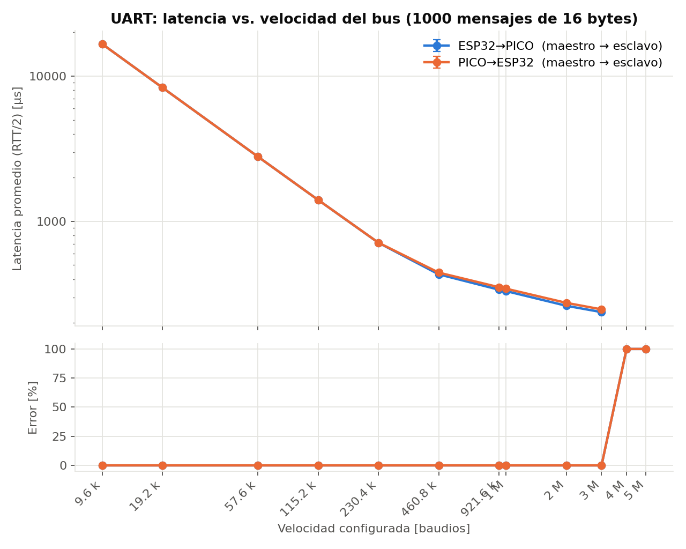
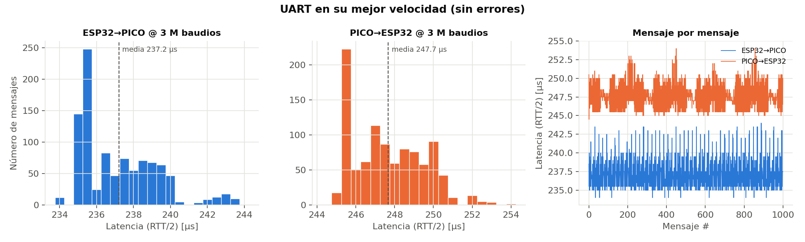
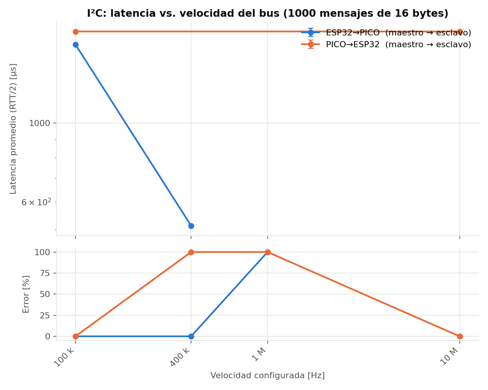
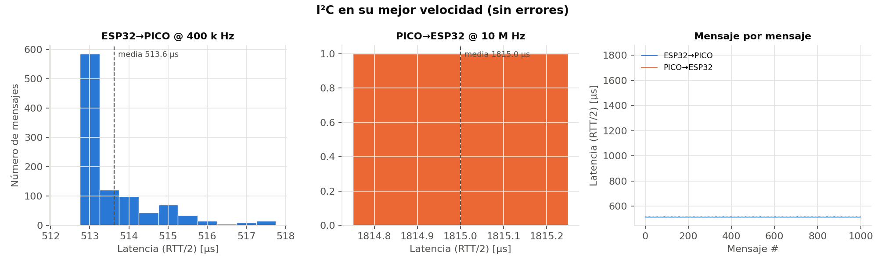
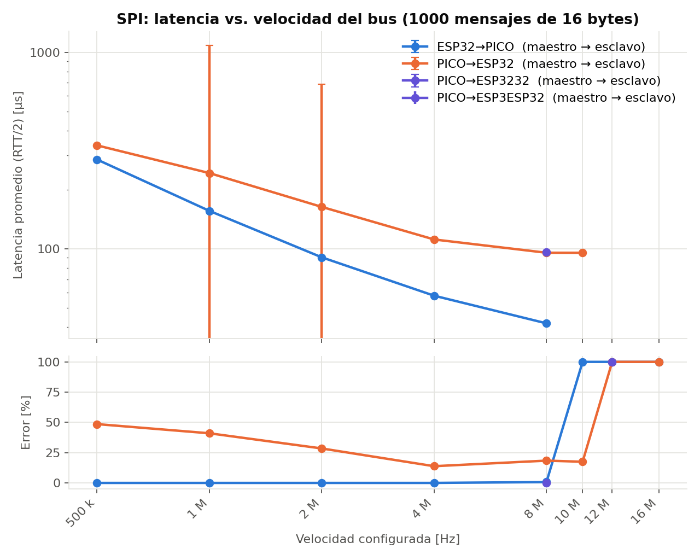
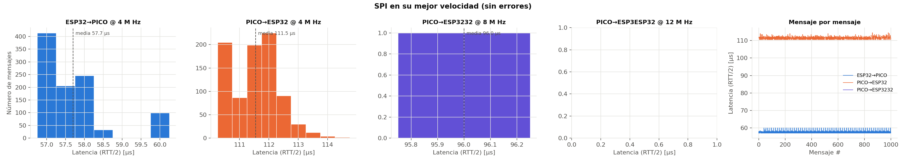
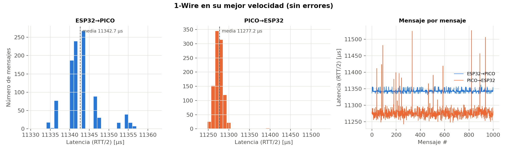
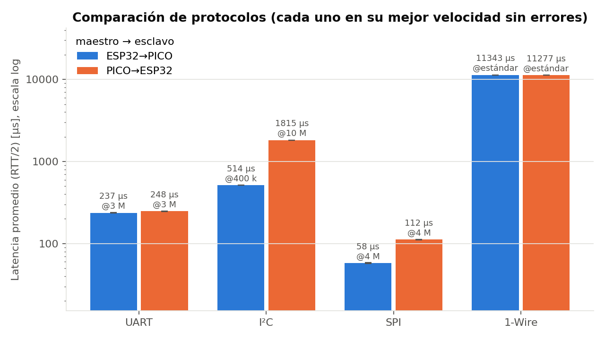

# Práctica 4: Protocolos de Comunicación entre Sistemas Embebidos (ESP32 y Raspberry Pi Pico)

**Autor:** Diego Márquez Esqueda

---

## Resumen

En este reporte se caracterizan dos plataformas de sistemas embebidos, una **ESP32 D1 Mini** (ESP32-D0WD-V3) y una **Raspberry Pi Pico** (RP2040), y se mide la latencia de comunicación entre ellas con cuatro protocolos serie: **UART, I²C, SPI y 1-Wire**. Para cada protocolo se implementó un esquema de eco (*ping-pong*): una placa actúa como maestro y envía 1000 mensajes de 16 bytes, la otra los regresa, y el maestro mide el tiempo de ida y vuelta (RTT) de cada uno. Las pruebas se hicieron en las dos combinaciones posibles (ESP32 como maestro y Pico como maestro) y, cuando el protocolo lo permite, barriendo la velocidad del bus para encontrar la máxima velocidad sin errores.

> **Nota sobre las plataformas:** la práctica originalmente pide un ATmega328 (Arduino) y una ESP32. Al no contar con un Arduino, se usó una Raspberry Pi Pico. Una ventaja de esta combinación es que **ambas placas trabajan a 3.3 V**, por lo que no se necesitó convertidor de niveles lógicos (con un Arduino UNO de 5 V sí habría sido necesario).

## Objetivos

- Identificar las características de cada plataforma: frecuencia, memoria, entradas/salidas y protocolos disponibles.
- Determinar el baudrate máximo de UART entre ambas plataformas y medir la latencia promedio enviando 1000 mensajes.
- Repetir la medición de latencia con I²C, SPI y 1-Wire.
- Evaluar la latencia en las diferentes combinaciones de plataformas (ESP32 → Pico y Pico → ESP32) y comparar los cuatro protocolos.

---

## Desarrollo

### 1. Características de las plataformas

Para obtener los datos de cada placa se cargó el programa `info_placa` (ver [Apéndice](#apéndice)), que imprime por el puerto serie el chip, los núcleos, la frecuencia, la memoria y los periféricos disponibles. La salida de cada placa fue:

```
========== INFORMACION DE LA PLACA ==========
Chip            : ESP32-D0WD-V3 (revision 301)
Nucleos         : 2
Frecuencia CPU  : 240 MHz
Flash           : 4194304 bytes (4.0 MB) a 80 MHz
RAM (heap)      : total 379388 bytes, libre 335296 bytes
PSRAM           : 0 bytes
Programa        : usa 279920 bytes, libres 1310720 bytes
GPIO            : 40 pines
UART            : 3
I2C             : 2
SPI             : 3 (incluye los usados por la flash)
SDK (ESP-IDF)   : v5.5.1-255-g07e9bf4970
==============================================
```

```
========== INFORMACION DE LA PLACA ==========
Chip            : RP2040 (Raspberry Pi Pico)
Nucleos         : 2
Frecuencia CPU  : 200 MHz
Flash           : 2097152 bytes (2.0 MB)
RAM (heap)      : total 253308 bytes, libre 252912 bytes
GPIO            : 30 pines
UART            : 2
I2C             : 2
SPI             : 2
PIO             : 2 bloques x 4 maquinas de estado
==============================================
```

Complementando con las hojas de datos de cada fabricante, la comparación queda como sigue:

| Característica | ESP32 D1 Mini (ESP32-D0WD-V3) | Raspberry Pi Pico (RP2040) |
|---|---|---|
| CPU | 2 × Xtensa LX6 (32 bits) | 2 × ARM Cortex-M0+ (32 bits) |
| Frecuencia | 240 MHz | 200 MHz (configurada por el core arduino-pico; nominal 133 MHz) |
| SRAM | 520 KB (≈379 KB disponibles como *heap*) | 264 KB (≈253 KB disponibles como *heap*) |
| Flash | 4 MB (externa, SPI) | 2 MB (externa, QSPI) |
| GPIO | 34 en el chip (el sistema reporta 40 posiciones) | 30 en el chip, 26 accesibles en la placa |
| UART | 3 (máx. ≈5 Mbps) | 2 (máx. ≈ clk_peri/16) |
| I²C | 2 (hasta 1 MHz) | 2 (hasta 1 MHz, *Fast-mode Plus*) |
| SPI | 4 (2 de uso general: HSPI y VSPI) | 2 |
| 1-Wire | No hay periférico (por software) | No hay periférico (por software o PIO) |
| Otros | Wi-Fi, Bluetooth/BLE, ADC 12 bits, DAC 8 bits, *touch*, PWM | PIO (8 máquinas de estado), ADC 12 bits, PWM, USB 1.1 nativo |
| Nivel lógico | 3.3 V | 3.3 V |
| USB | Puente USB-serie externo (CH340/CH9102) → UART0 | USB nativo del RP2040 (puerto CDC virtual) |

*Tabla 1. Características de las plataformas utilizadas.*

#### Diagramas de arquitectura

```
+------------------------------------------------------------------+
|                  ESP32 D1 Mini (ESP32-D0WD-V3)                    |
|                                                                  |
|  +----------------------+   +----------------+  +-------------+  |
|  | 2 x Xtensa LX6       |   | SRAM 520 KB    |  | Flash 4 MB  |  |
|  | 240 MHz (FreeRTOS)   |<->| ROM  448 KB    |<->| (SPI ext.)  |  |
|  +----------+-----------+   +----------------+  +-------------+  |
|             |            bus interno + matriz de GPIO            |
|  +----------+--------------------------------------------------+ |
|  | UART0 UART1 UART2 | I2C0 I2C1 | SPI (HSPI, VSPI) | LEDC PWM | |
|  | ADC 12 b | DAC 8 b | Touch | Wi-Fi 802.11 b/g/n | BT / BLE   | |
|  +-------------------------------------------------------------+ |
|                                                                  |
|  PC <--USB--> [CH340 / CH9102] <--> UART0 (programación + Serial) |
+------------------------------------------------------------------+
```

```
+------------------------------------------------------------------+
|                 Raspberry Pi Pico (RP2040)                        |
|                                                                  |
|  +----------------------+   +----------------+  +-------------+  |
|  | 2 x Cortex-M0+       |   | SRAM 264 KB    |  | Flash 2 MB  |  |
|  | 200 MHz              |<->| (6 bancos)     |<->| (QSPI ext.) |  |
|  +----------+-----------+   +----------------+  +-------------+  |
|             |               bus AHB / APB                        |
|  +----------+--------------------------------------------------+ |
|  | UART0 UART1 | I2C0 I2C1 | SPI0 SPI1 | PWM x16 | ADC 12 b x4  | |
|  | PIO0 + PIO1 (8 máquinas de estado programables)  | Timer     | |
|  +-------------------------------------------------------------+ |
|                                                                  |
|  PC <--USB--> USB 1.1 nativo del RP2040 (CDC: Serial virtual)     |
+------------------------------------------------------------------+
```

Una diferencia importante para esta práctica es cómo llega el puerto serie a la PC: la ESP32 usa un chip puente (CH340) conectado a su UART0, mientras que la Pico implementa el USB directamente en el microcontrolador. Esto influyó en algunos problemas de captura descritos más adelante.

### 2. Entorno de trabajo

- **IDE:** Arduino IDE 2.x con el core **esp32** de Espressif (v3.x) y el core **arduino-pico** de Earle F. Philhower para la Pico. Usar Arduino en ambas placas permitió escribir un solo programa por prueba que compila para las dos (se detecta la placa con `#if defined(ARDUINO_ARCH_ESP32)` / `ARDUINO_ARCH_RP2040`), lo que hace la comparación más justa.
- **Librerías:** `Wire` y `SPI` (incluidas en cada core), `SPISlave` (incluida en arduino-pico) y `ESP32SPISlave` de hideakitai para el esclavo SPI en la ESP32.
- **Captura y análisis:** dos scripts de Python: `capturar.py` (abre el puerto del maestro, inicia la prueba y guarda los datos en CSV) y `graficar.py` (calcula estadísticas y genera las gráficas). Ambos están en el [Apéndice](#apéndice).

### 3. Metodología de medición

Para los cuatro protocolos se usó el mismo esquema de eco (*ping-pong*):

```
        MAESTRO (mide)                               ESCLAVO (eco)
             |                                            |
   t0 = micros()                                          |
             |------ paquete de 16 bytes --------------->|
             |                                            |  lo guarda y
             |<----- el mismo paquete de regreso ---------|  lo regresa
   t1 = micros()                                          |
             |                                            |
   RTT = t1 - t0          Latencia en un sentido ≈ RTT / 2
```

- **Paquete:** 16 bytes = encabezado `0xA5`, número de secuencia (2 bytes), 12 bytes de datos y un byte de verificación (XOR). Se cuenta como **error** si el eco no llega a tiempo o no es idéntico al enviado.
- **Muestras:** 10 mensajes de "calentamiento" (no medidos) y después **1000 mensajes medidos** por cada velocidad y cada dirección.
- **Medición:** solo con el reloj del maestro (`micros()`, resolución de 1 µs), por lo que no fue necesario sincronizar los relojes de las dos placas.
- **Reporte:** el maestro guarda los 1000 RTT en memoria y los imprime **al terminar** cada prueba, junto con una línea `# RESUMEN` con sus estadísticas, para que la impresión por USB no afecte la medición.
- **Combinaciones:** cada protocolo se probó en dos direcciones, **ESP32 → Pico** (ESP32 maestro) y **Pico → ESP32** (Pico maestro), cargando el programa `maestro` o `esclavo` correspondiente en cada placa.

La latencia en un sentido se reporta como:

$$
Latencia \approx \frac{RTT}{2} = \frac{t_1 - t_0}{2}
$$

---

### 4. Prueba UART

#### Conexión

```
     ESP32 D1 Mini                               Raspberry Pi Pico
   +----------------+                          +-------------------+
   |  IO17 (TX2)   o|------------------------->|o GP1  (UART0 RX)  |
   |  IO16 (RX2)   o|<-------------------------|o GP0  (UART0 TX)  |
   |  GND          o|--------------------------|o GND              |
   +-------+--------+                          +---------+---------+
           | USB (COM10)                                 | USB (COM8)
           +-------------------> PC <--------------------+
```

#### Procedimiento

1. Se conectaron TX y RX cruzados y GND común entre las placas.
2. Se cargó `uart_esclavo` en la Pico y `uart_maestro` en la ESP32, y se capturó con `capturar.py`. Después se intercambiaron los programas para la dirección Pico → ESP32.
3. Para encontrar el **baudrate máximo**, el maestro barre automáticamente 12 velocidades: 9600, 19200, 57600, 115200, 230400, 460800, 921600 baudios, 1, 2, 3, 4 y 5 Mbaud. Antes de cada velocidad, el maestro avisa al esclavo del cambio mediante un paquete de configuración (`0x5A`) enviado a 115200 baudios (canal de control). Si el esclavo pasa 500 ms sin recibir datos, regresa solo al canal de control.

#### Resultados

| Baudrate | ESP32 → Pico: éxito | RTT medio (µs) | Latencia (µs) | Pico → ESP32: éxito | RTT medio (µs) | Latencia (µs) |
|---|---|---|---|---|---|---|
| 9 600 | 1000/1000 | 33 284.7 | 16 642.3 | 1000/1000 | 33 286.9 | 16 643.4 |
| 19 200 | 1000/1000 | 16 665.7 | 8 332.9 | 1000/1000 | 16 666.1 | 8 333.1 |
| 57 600 | 1000/1000 | 5 577.2 | 2 788.6 | 1000/1000 | 5 577.7 | 2 788.9 |
| 115 200 | 1000/1000 | 2 807.4 | 1 403.7 | 1000/1000 | 2 807.4 | 1 403.7 |
| 230 400 | 1000/1000 | 1 424.7 | 712.3 | 1000/1000 | 1 426.1 | 713.1 |
| 460 800 | 1000/1000 | 863.6 | 431.8 | 1000/1000 | 887.5 | 443.8 |
| 921 600 | 1000/1000 | 676.8 | 338.4 | 1000/1000 | 704.0 | 352.0 |
| 1 M | 1000/1000 | 662.1 | 331.0 | 1000/1000 | 687.6 | 343.8 |
| 2 M | 1000/1000 | 524.6 | 262.3 | 1000/1000 | 549.4 | 274.7 |
| **3 M** | **1000/1000** | **474.4** | **237.2** | **1000/1000** | **495.3** | **247.7** |
| 4 M | 0/1000 | — | — | 0/1000 | — | — |
| 5 M | 0/1000 | — | — | 0/1000 | — | — |

*Tabla 2. Resultados de UART (1000 mensajes de 16 bytes por velocidad). La desviación estándar del RTT estuvo entre 2.2 y 4.5 µs en todos los casos.*



*Figura 1. Latencia promedio y porcentaje de error de UART en función del baudrate, en ambas direcciones.*



*Figura 2. Distribución de la latencia de UART a 3 Mbaud y latencia mensaje por mensaje.*

**Baudrate máximo.** El enlace funcionó sin errores hasta **3 Mbaud en ambas direcciones**; a 4 y 5 Mbaud no se recibió ningún eco. Según las hojas de datos, la UART de la ESP32 llega a ≈5 Mbps y la del RP2040 a clk_peri/16, así que el límite práctico de 3 Mbaud lo pusieron las condiciones físicas del montaje (cables tipo *jumper* sin blindaje, tiempos de subida) y no el límite teórico de los periféricos. Sin osciloscopio no fue posible confirmar cuál de los dos lados falla primero.

**Comportamiento de la latencia.** A baudrates bajos, el RTT coincide casi exactamente con el tiempo que tarda en viajar el paquete por el cable. Cada byte usa 10 bits (inicio + 8 datos + parada) y el paquete viaja dos veces, por lo que $RTT_{teórico} = 2 \cdot 16 \cdot 10 / baud$: a 9600 baudios eso da 33 333 µs, y se midieron 33 285 µs. A partir de ≈460 800 baudios aparece un costo adicional de procesamiento por software que, desde 921 600 baudios, se estabiliza en **≈330–390 µs** por viaje redondo (interrupciones y *buffers* de los drivers UART de ambas placas). Ese costo domina a velocidades altas: pasar de 1 a 3 Mbaud solo redujo la latencia de 331 a 237 µs. Las dos direcciones son prácticamente simétricas: a partir de 460 800 baudios, la dirección Pico → ESP32 tuvo ≈10–14 µs más de latencia (menos de 5 % de diferencia).

---

### 5. Prueba I²C

#### Conexión

```
     ESP32 D1 Mini                               Raspberry Pi Pico
   +----------------+          SDA             +-------------------+
   |  IO21 (SDA)   o|<========================>|o GP4  (I2C0 SDA)  |
   |                |          SCL             |                   |
   |  IO22 (SCL)   o|<========================>|o GP5  (I2C0 SCL)  |
   |  GND          o|--------------------------|o GND              |
   +----------------+                          +-------------------+

   Sin resistencias pull-up externas: el bus usó solo las pull-ups
   internas de ambas placas (≈45–50 kΩ). Dirección del esclavo: 0x42.
```

Los mismos cables sirven para las dos direcciones; solo cambia qué programa se carga en cada placa.

#### Procedimiento

1. Se cargó `i2c_esclavo` (dirección `0x42`) en una placa e `i2c_maestro` en la otra. Antes de iniciar, el maestro verifica que el esclavo responda en el bus (`Esclavo 0x42 DETECTADO`).
2. Cada *ping* consiste en una escritura de 16 bytes al esclavo seguida de una lectura de 16 bytes.
3. Se barrieron tres velocidades: **100 kHz** (*Standard*), **400 kHz** (*Fast*) y **1 MHz** (*Fast-mode Plus*).
4. Diferencia entre esclavos: la **Pico** como esclava **estira el reloj** (*clock stretching*) mientras prepara la respuesta, así que el maestro puede leer inmediatamente. La **ESP32** como esclava **no estira el reloj**: deja la respuesta precargada al recibir los datos, y por eso, cuando la Pico es maestro, se agregó una espera fija `ESPERA_US = 300 µs` entre la escritura y la lectura.

#### Resultados

| Velocidad | ESP32 → Pico: éxito | RTT medio (µs) | Latencia (µs) | Pico → ESP32: éxito | RTT medio (µs) | Latencia (µs) |
|---|---|---|---|---|---|---|
| **100 kHz** | **1000/1000** | **3 335.4** | **1 667.7** | **1000/1000** | **3 630.6** | **1 815.3** |
| **400 kHz** | **1000/1000** | **1 027.2** | **513.6** | 0/1000 | — | — |
| 1 MHz | 0/1000 | — | — | 0/1000 | — | — |

*Tabla 3. Resultados de I²C (1000 mensajes de 16 bytes por velocidad). Desviación estándar del RTT: 0.5–2.0 µs.*



*Figura 3. Latencia promedio y porcentaje de error de I²C en función de la frecuencia del bus.*



*Figura 4. Distribución de la latencia de I²C en la mejor velocidad de cada dirección.*

**Velocidad máxima.** Con la ESP32 como maestro, el bus funcionó sin errores hasta **400 kHz**. Con la Pico como maestro, solo funcionó a **100 kHz**. A 1 MHz falló en ambas direcciones. La causa más probable es la **falta de resistencias pull-up externas**: en I²C los dispositivos solo jalan la línea a 0, y lo que la regresa a 1 es la pull-up. Con las internas de ≈45–50 kΩ la línea sube muy lento, y a 1 MHz los flancos no alcanzan a formarse dentro del periodo del reloj. En la dirección Pico → ESP32 se suma la limitación del esclavo ESP32, que no puede estirar el reloj.

**Latencia.** Un *ping* de I²C transmite ≈310 bits (dirección + 16 bytes de datos, cada uno con su bit de ACK, en la escritura y en la lectura), es decir ≈3 100 µs a 100 kHz y ≈775 µs a 400 kHz. Los valores medidos (3 335 y 1 027 µs) muestran un costo extra de ≈240–250 µs por software. La diferencia entre las dos direcciones a 100 kHz (3 630.6 − 3 335.4 ≈ 295 µs) coincide casi exactamente con la espera de 300 µs que se agregó porque la ESP32 no estira el reloj. Es decir, la asimetría entre direcciones la causa la capacidad del **esclavo**, no la del maestro.

---

### 6. Prueba SPI

#### Conexión

```
     ESP32 D1 Mini                               Raspberry Pi Pico
   +----------------+                          +-------------------+
   |  IO18         o|---------- SCK -----------|o GP18             |
   |  IO5          o|---------- CS ------------|o GP17             |
   |  IO23         o|<--------------------------|o GP19 (SPI0 TX)   |
   |  IO19         o|-------------------------->|o GP16 (SPI0 RX)   |
   |  GND          o|--------------------------|o GND              |
   +----------------+                          +-------------------+

   Rol de cada línea según qué placa es maestro (mismos cables):

   Cable           | ESP32 maestro / Pico esclavo | Pico maestro / ESP32 esclavo
   ----------------+------------------------------+-----------------------------
   IO18 <-> GP18   | SCK  (sale de la ESP32)      | SCK  (sale de la Pico)
   IO5  <-> GP17   | CS   (sale de la ESP32)      | CS   (sale de la Pico)
   IO23 <-  GP19   | MISO (Pico -> ESP32)         | MOSI (Pico -> ESP32)
   IO19 ->  GP16   | MOSI (ESP32 -> Pico)         | MISO (ESP32 -> Pico)
```

Los pines de SPI0 de la Pico tienen función fija (GP19 siempre transmite y GP16 siempre recibe), así que en la ESP32 se aprovechó su matriz de GPIO para reasignar MOSI y MISO por software según su rol. De esta forma no fue necesario recablear al cambiar de dirección.

#### Procedimiento

1. Se usó **modo SPI 3** (CPOL = 1, CPHA = 1) en ambas placas. Con CPHA = 0, el periférico SPI del RP2040 en modo esclavo requiere que CS suba entre cada byte, lo que impide enviar el paquete completo en una sola transacción.
2. En SPI el esclavo solo puede contestar durante la **siguiente** transacción, así que cada *ping* son **dos transacciones de 16 bytes**: T1 (el maestro envía el paquete) y T2 (el maestro envía ceros y recibe el eco). Entre ambas se espera `ESPERA_US` para que el esclavo cargue la respuesta: 20 µs con la Pico como esclava (la carga en su interrupción) y 150 µs con la ESP32 como esclava (su driver vuelve a encolar la transacción desde una tarea de FreeRTOS).
3. Se barrieron 8 frecuencias de reloj: 0.5, 1, 2, 4, 8, 10, 12 y 16 MHz.

#### Resultados

| Frecuencia | ESP32 → Pico: éxito | RTT medio (µs) | Latencia (µs) | Pico → ESP32: éxito | RTT medio (µs) | Latencia (µs) |
|---|---|---|---|---|---|---|
| 0.5 MHz | 1000/1000 | 569.3 | 284.7 | 515/1000 | 672.2 | 336.1 |
| 1 MHz | 1000/1000 | 311.9 | 155.9 | 590/1000 | 415.9 | 207.9 |
| 2 MHz | 1000/1000 | 181.0 | 90.5 | 716/1000 | 287.4 | 143.7 |
| **4 MHz** | **1000/1000** | **115.4** | **57.7** | 862/1000 | 223.1 | 111.5 |
| 8 MHz | 993/1000 | 83.5 | 41.7 | 817/1000 | 190.9 | 95.5 |
| 10 MHz | 0/1000 | — | — | 826/1000 | 190.8 | 95.4 |
| 12 MHz | 0/1000 | — | — | 0/1000 | — | — |
| 16 MHz | 0/1000 | — | — | 0/1000 | — | — |

*Tabla 4. Resultados de SPI (1000 mensajes de 16 bytes por frecuencia). Desviación estándar del RTT: 1.1–3.2 µs.*



*Figura 5. Latencia promedio y porcentaje de error de SPI en función de la frecuencia del reloj.*



*Figura 6. Distribución de la latencia de SPI en la mejor velocidad de cada dirección.*

**ESP32 → Pico.** Fue la combinación más rápida de toda la práctica: **0 % de error hasta 4 MHz**, con una latencia de **57.7 µs**. A 8 MHz aparecieron los primeros errores (0.7 %), y desde 10 MHz la comunicación falló por completo. El límite lo pone la Pico como esclava: su FIFO de transmisión solo tiene 8 posiciones y debe rellenarse desde una interrupción mientras el maestro sigue enviando reloj, por lo que a frecuencias altas la interrupción no alcanza a tiempo. Además, el periférico SPI del RP2040 en modo esclavo requiere un reloj de periférico al menos 12 veces mayor que SCK.

**Pico → ESP32.** Esta dirección funcionó en todas las frecuencias hasta 10 MHz, pero **con errores en todas ellas (14–49 %)**. Los errores provienen del **esclavo ESP32**: su driver SPI de esclavo vuelve a preparar cada transacción desde una tarea de FreeRTOS, y con 150 µs de espera no siempre alcanza a tenerla lista para T2. Que el porcentaje de error baje al aumentar la frecuencia es consistente con esta explicación: con transacciones más cortas cambia la fase entre el maestro y la tarea del esclavo. Con una espera mayor probablemente bajarían los errores, a costa de más latencia; eso no se probó en esta práctica. Por otro lado, 8 y 10 MHz dieron exactamente el mismo RTT (≈190.9 µs), lo que indica que el divisor de reloj de la Pico produce la misma frecuencia real para ambos valores solicitados.

**Latencia.** El tiempo de bus de un *ping* es $2 \cdot 16 \cdot 8 / f$ (64 µs a 4 MHz). Sumando la espera de 20 µs queda un costo de software de ≈30 µs por *ping* en la dirección ESP32 → Pico, mucho menor que en UART. En la dirección Pico → ESP32 la espera de 150 µs domina el RTT.

---

### 7. Prueba 1-Wire

#### Conexión

```
                             3V3 (de una sola placa)
                                    |
                                   [R] 4.7 kΩ  (pull-up)
                                    |
     ESP32 D1 Mini                  |               Raspberry Pi Pico
   +----------------+               |             +-------------------+
   |  IO4          o|---------------+-------------|o GP15             |
   |                |          DQ (datos)         |                   |
   |  GND          o|-----------------------------|o GND              |
   +----------------+                             +-------------------+
```

#### Procedimiento

1. Ninguna de las dos placas tiene un periférico de hardware para 1-Wire, y no existe una librería estándar para que un microcontrolador *sea* esclavo 1-Wire. Por ello, **maestro y esclavo se implementaron por software** (*bit-banging*), con los tiempos de velocidad estándar de la nota de aplicación AN126 de Maxim:
   - Reset: 480 µs en bajo, muestreo del pulso de presencia a los 70 µs.
   - Escribir 1: 6 µs en bajo. Escribir 0: 60 µs en bajo. Leer: 6 µs en bajo y muestreo a los 15 µs.
   - Cada bit ocupa ≈70 µs (≈14.3 kbit/s nominales).
2. El esclavo emula un dispositivo tipo DS18B20 con un *scratchpad* de 16 bytes, y cada *ping* consta de dos tramas:

```
   RESET -> presencia -> 0xCC (Skip ROM) -> 0x4E (Write Scratchpad) -> 16 bytes
   RESET -> presencia -> 0xCC (Skip ROM) -> 0xBE (Read Scratchpad)  <- 16 bytes
```

3. El esclavo vigila la línea en un ciclo y reacciona a cada flanco de bajada del maestro. Durante cada trama (≈23 ms) desactiva las interrupciones para que los tiempos sean exactos.
4. Se agregó una resistencia pull-up de 4.7 kΩ entre DQ y 3V3. Además, el maestro verifica el estado de la línea en reposo antes de empezar.

#### Resultados

| Dirección | Éxito | RTT medio (µs) | Desv. est. (µs) | RTT mín / máx (µs) | Latencia (µs) |
|---|---|---|---|---|---|
| ESP32 → Pico | 1000/1000 | 22 685.3 | 8.9 | 22 663 / 22 723 | 11 342.7 |
| Pico → ESP32 | 1000/1000 | 22 554.4 | 43.9 | 22 485 / 23 053 | 11 277.2 |

*Tabla 5. Resultados de 1-Wire en velocidad estándar (1000 mensajes de 16 bytes).*



*Figura 7. Distribución de la latencia de 1-Wire y latencia mensaje por mensaje en ambas direcciones.*

**Latencia.** El tiempo teórico de un *ping* se calcula con los tiempos del protocolo: 2 resets de 960 µs, la trama de escritura (2 comandos + 16 bytes = 18 bytes × 8 bits × 70 µs) y la trama de lectura (2 comandos escritos + 16 bytes leídos). En total da **≈22 080 µs**. Lo medido (22 554–22 685 µs) está a menos de 3 % de ese valor. Esto confirma que en 1-Wire la latencia está determinada casi por completo por los tiempos fijos del protocolo, y que el *throughput* útil (≈11.3 kbit/s) es el más bajo de los cuatro protocolos.

**Diferencia entre direcciones.** Ambas direcciones funcionaron sin errores. La dirección Pico → ESP32 fue ligeramente más rápida (65 µs menos en promedio) pero con **5 veces más variación** (desviación de 43.9 µs y picos de hasta 23 053 µs, visibles en la Figura 7). En 1-Wire todos los tiempos los impone el **maestro**, así que esa variación viene de la Pico: entre bit y bit su maestro reactiva las interrupciones, y el USB nativo del RP2040 las usa constantemente para mantener el puerto serie. La ESP32 no tiene ese problema porque su USB lo maneja un chip externo.

---

### 8. Problemas encontrados y soluciones

| Problema | Causa | Solución |
|---|---|---|
| Caracteres basura en el Monitor Serie de la ESP32 | El monitor estaba en 9600 y el maestro imprime por USB a 921600 baudios (el 9600 es la velocidad del enlace entre placas, no la del USB) | Configurar el monitor a 921600 baudios |
| `Failed to connect to ESP32: No serial data received` al programar | La D1 Mini no siempre entra sola en modo de programación | Mantener presionado BOOT durante `Connecting...` |
| El maestro ESP32 no imprimía nada después de programarlo | La placa se quedó en modo de programación tras la carga manual | Presionar RST/EN después de cada carga |
| `ESP32SPISlave.h: No such file or directory` | La librería de esclavo SPI para ESP32 no viene con el core | Instalar `ESP32SPISlave` desde el gestor de bibliotecas |
| 1-Wire: "presencia: SI" pero 0/1000 mensajes | Sin pull-up la línea quedaba flotando y el maestro leía siempre 0 (falso pulso de presencia) | Agregar pull-up de 4.7 kΩ; activar las pull-ups internas como respaldo; verificar el estado de la línea en reposo |
| 1-Wire Pico → ESP32: "línea en reposo: BAJO" | La ESP32 estaba desenergizada y su pin hundía la línea a GND | Alimentar la ESP32 antes de iniciar la prueba |
| La Pico perdía el puerto COM al energizar la ESP32 / `PermissionError: Acceso denegado` | Cables de pruebas anteriores aún conectados y puerto ocupado por otro programa | Retirar todo el cableado previo, cerrar Arduino IDE y reconectar la Pico |
| Unas pocas líneas del CSV corruptas en las capturas de la Pico (nombres como `ESP3232`, RTT de 41 416 µs) | Líneas que se pegaron o perdieron caracteres al pasar por el USB CDC de la Pico | `graficar.py` descarta esas líneas; los valores de este reporte se tomaron de las líneas `# RESUMEN` que calculó el propio maestro |

*Tabla 6. Problemas encontrados durante la práctica.*

---

## Resultados

### Comparación de los cuatro protocolos

| Protocolo | Dirección | Velocidad máx. sin errores | Latencia media (µs) | *Throughput* útil (kbit/s) |
|---|---|---|---|---|
| UART | ESP32 → Pico | 3 Mbaud | 237.2 | 539.6 |
| UART | Pico → ESP32 | 3 Mbaud | 247.7 | 516.8 |
| I²C | ESP32 → Pico | 400 kHz | 513.6 | 249.2 |
| I²C | Pico → ESP32 | 100 kHz | 1 815.3 | 70.5 |
| **SPI** | **ESP32 → Pico** | **4 MHz** | **57.7** | **2 218.4** |
| SPI | Pico → ESP32 | — (13.8 % de error en su mejor caso, 4 MHz) | 111.5 | 1 147.5 |
| 1-Wire | ESP32 → Pico | Estándar (≈14.3 kbit/s) | 11 342.7 | 11.3 |
| 1-Wire | Pico → ESP32 | Estándar (≈14.3 kbit/s) | 11 277.2 | 11.4 |

*Tabla 7. Mejor resultado de cada protocolo y dirección. El throughput útil considera los 32 bytes de datos que viajan en cada ping (16 de ida y 16 de vuelta).*



*Figura 8. Latencia promedio de cada protocolo en su mejor velocidad (escala logarítmica). En SPI Pico → ESP32 se muestra la frecuencia con menos errores, aunque ninguna tuvo 0 %.*

> **Nota:** la captura de las salidas de consola de donde se tomaron estos valores se encuentra en la sección de [Datos crudos](#datos-crudos), al final del apéndice.

---

## Conclusión

### Baudrate máximo de UART

Ambas plataformas lograron comunicarse por UART sin errores hasta **3 Mbaud**, en las dos direcciones; a 4 y 5 Mbaud la comunicación falló por completo. Aunque los periféricos de la ESP32 (≈5 Mbps) y del RP2040 (clk_peri/16) admiten velocidades mayores en teoría, el límite práctico lo impuso el montaje físico con cables tipo *jumper*. Además, subir el baudrate dejó de ser rentable a partir de ≈1 Mbaud: el procesamiento por software de los drivers (≈350 µs por viaje redondo) pasó a dominar la latencia, por lo que triplicar el baudrate de 1 a 3 Mbaud solo redujo la latencia de 331 a 237 µs.

### Comparación entre protocolos

**SPI** fue el protocolo con menor latencia (57.7 µs en la dirección ESP32 → Pico), unas 4 veces menos que UART (237 µs), 9 veces menos que I²C (514 µs) y casi 200 veces menos que 1-Wire (11.3 ms). Este orden refleja la naturaleza de cada protocolo:

- **SPI** tiene reloj compartido, líneas separadas para cada sentido y no tiene direcciones ni confirmaciones: es el más rápido, a costa de usar 4 cables.
- **UART** es asíncrono y solo agrega los bits de inicio y parada, pero depende de que ambos relojes coincidan, y a velocidades altas lo limita el procesamiento por software.
- **I²C** agrega dirección y un bit de ACK por cada byte, y es *half-duplex*. A cambio usa solo 2 cables compartibles entre muchos dispositivos.
- **1-Wire** usa un solo cable y tiempos de bit de ≈70 µs. Es el más lento, pero el más simple en cableado. Además, su latencia fue la más predecible respecto a la teoría (menos de 3 % de diferencia).

### Efecto de la combinación de plataformas

La dirección de la comunicación sí importó, y la diferencia vino casi siempre de las capacidades de la placa que actúa como **esclavo**:

- En **UART**, donde no hay maestro ni esclavo reales, las dos direcciones fueron prácticamente iguales (diferencias menores a 5 %).
- En **I²C**, la Pico como esclava estira el reloj y respondió de inmediato, mientras que la ESP32 como esclava necesitó una espera de 300 µs. Esa espera explica exactamente la diferencia de latencia entre direcciones (≈295 µs), y además la ESP32 como esclava solo funcionó a 100 kHz.
- En **SPI**, la Pico como esclava respondió sin errores hasta 4 MHz, mientras que la ESP32 como esclava tuvo errores en todas las frecuencias, debido a que su driver prepara cada transacción desde una tarea de FreeRTOS.
- En **1-Wire**, donde todos los tiempos los marca el maestro, la Pico como maestro mostró más variación por las interrupciones de su USB nativo.

En resumen, **la Pico resultó mejor esclava** (sus periféricos responden en interrupciones de pocos µs y soporta *clock stretching*), mientras que **la ESP32 resultó mejor maestro** (su sistema operativo FreeRTOS agrega retardos poco predecibles cuando tiene que reaccionar como esclava). Para un sistema con ambas placas, la combinación recomendada es **ESP32 como maestro y Pico como esclava**, comunicadas por **SPI** cuando se necesita la menor latencia, o por **UART** cuando se busca simplicidad y robustez con solo 2 cables de datos.

### Conclusión general

En esta práctica se caracterizaron dos plataformas embebidas distintas (ESP32 y RP2040) y se midió la latencia de comunicación entre ellas con cuatro protocolos serie, usando un mismo esquema de eco y 1000 mensajes por prueba. Los resultados confirmaron el orden esperado de desempeño (SPI < UART < I²C < 1-Wire en latencia). También mostraron que, en la práctica, **la latencia real no depende solo de la velocidad del bus**, sino también del procesamiento por software de cada plataforma y de sus capacidades como esclavo, y que las condiciones físicas del montaje (cables, resistencias pull-up) definen el límite real de velocidad muy por debajo del teórico. La falta de pull-ups externas en I²C limitó ese bus a 400 kHz, y en 1-Wire una sola resistencia fue la diferencia entre 0 % y 100 % de comunicación. Esto refuerza la importancia de cuidar tanto el hardware como el software al integrar sistemas ciberfísicos.

---

## Apéndice

Todos los programas de Arduino compilan sin cambios para la ESP32 y para la Raspberry Pi Pico: cada uno detecta en qué placa está y selecciona sus pines automáticamente.

### Características de la placa

<details markdown="block">
<summary>info_placa.ino — clic para expandir</summary>

```cpp
/*
  Práctica 4 · Paso 1 — Características de la placa
  ---------------------------------------------------
  Carga este mismo programa en la ESP32 y en la Raspberry Pi Pico.
  Imprime cada 5 s: chip, núcleos, frecuencia, memoria y periféricos.
  Copia lo que salga en el Monitor Serie (115200) para tu tabla comparativa.
*/
#include <Arduino.h>

#if defined(ARDUINO_ARCH_ESP32)
  #include "soc/soc_caps.h"
#elif defined(ARDUINO_ARCH_RP2040)
  #include "hardware/platform_defs.h"
#endif

void setup() {
  Serial.begin(115200);
  unsigned long t0 = millis();
  while (!Serial && millis() - t0 < 4000) {}
  delay(500);
}

void loop() {
  Serial.println();
  Serial.println("========== INFORMACION DE LA PLACA ==========");

#if defined(ARDUINO_ARCH_ESP32)
  Serial.printf("Chip            : %s (revision %d)\n", ESP.getChipModel(), ESP.getChipRevision());
  Serial.printf("Nucleos         : %d\n", ESP.getChipCores());
  Serial.printf("Frecuencia CPU  : %u MHz\n", (unsigned)ESP.getCpuFreqMHz());
  Serial.printf("Flash           : %u bytes (%.1f MB) a %u MHz\n",
                (unsigned)ESP.getFlashChipSize(), ESP.getFlashChipSize() / 1048576.0,
                (unsigned)(ESP.getFlashChipSpeed() / 1000000));
  Serial.printf("RAM (heap)      : total %u bytes, libre %u bytes\n",
                (unsigned)ESP.getHeapSize(), (unsigned)ESP.getFreeHeap());
  Serial.printf("PSRAM           : %u bytes\n", (unsigned)ESP.getPsramSize());
  Serial.printf("Programa        : usa %u bytes, libres %u bytes\n",
                (unsigned)ESP.getSketchSize(), (unsigned)ESP.getFreeSketchSpace());
  Serial.printf("GPIO            : %d pines\n", SOC_GPIO_PIN_COUNT);
  Serial.printf("UART            : %d\n", SOC_UART_NUM);
  Serial.printf("I2C             : %d\n", SOC_I2C_NUM);
  Serial.printf("SPI             : %d (incluye los usados por la flash)\n", SOC_SPI_PERIPH_NUM);
  Serial.printf("SDK (ESP-IDF)   : %s\n", ESP.getSdkVersion());

#elif defined(ARDUINO_ARCH_RP2040)
  #if defined(PICO_RP2350)
    Serial.println("Chip            : RP2350 (Raspberry Pi Pico 2)");
  #else
    Serial.println("Chip            : RP2040 (Raspberry Pi Pico)");
  #endif
  Serial.println("Nucleos         : 2");
  Serial.printf("Frecuencia CPU  : %lu MHz\n", (unsigned long)(rp2040.f_cpu() / 1000000));
  Serial.printf("Flash           : %lu bytes (%.1f MB)\n",
                (unsigned long)PICO_FLASH_SIZE_BYTES, PICO_FLASH_SIZE_BYTES / 1048576.0);
  Serial.printf("RAM (heap)      : total %d bytes, libre %d bytes\n",
                rp2040.getTotalHeap(), rp2040.getFreeHeap());
  Serial.printf("GPIO            : %d pines\n", NUM_BANK0_GPIOS);
  Serial.printf("UART            : %d\n", NUM_UARTS);
  Serial.printf("I2C             : %d\n", NUM_I2CS);
  Serial.printf("SPI             : %d\n", NUM_SPIS);
  Serial.printf("PIO             : %d bloques x 4 maquinas de estado\n", NUM_PIOS);

#else
  Serial.println("Placa no reconocida");
#endif

  Serial.println("==============================================");
  delay(5000);
}
```

</details>

### UART

<details markdown="block">
<summary>uart_maestro.ino — clic para expandir</summary>

```cpp
/*
  Práctica 4 · UART — MAESTRO (mide la latencia)
  ------------------------------------------------
  Compila igual para ESP32 y para Raspberry Pi Pico (core arduino-pico).
  La otra placa debe tener cargado uart_esclavo.

  Qué hace:
    1. Espera que le mandes 'r' por el Monitor Serie (o que lo mande capturar.py).
    2. Para cada baudrate de la lista BAUDS:
         - avisa al esclavo del nuevo baudrate (a 115200, canal de control)
         - envía 1000 paquetes de 16 bytes y mide el tiempo de ida y vuelta (RTT)
           de cada uno con micros(); el esclavo regresa el paquete tal cual (eco)
    3. Imprime todo en formato CSV por el USB y un resumen por baudrate.

  Latencia en un sentido ≈ RTT / 2.

  Conexión (cruzada):
      ESP32 GPIO17 (TX2) ---> Pico GP1 (RX)
      ESP32 GPIO16 (RX2) <--- Pico GP0 (TX)
      GND --------------------- GND
*/
#include <Arduino.h>

// ======================= CONFIGURACIÓN =======================
const uint32_t N_MENSAJES   = 1000;      // mensajes por prueba
const uint8_t  TAM          = 16;        // bytes por paquete
const uint32_t BAUD_CONTROL = 115200;    // baudrate para negociar cambios
const uint32_t BAUDS[] = {9600, 19200, 57600, 115200, 230400, 460800, 921600,
                          1000000, 2000000, 3000000, 4000000, 5000000};
const uint8_t  N_BAUDS = sizeof(BAUDS) / sizeof(BAUDS[0]);
const uint32_t N_CALENTAMIENTO = 10;     // paquetes no medidos tras cambiar baudrate
// =============================================================

#if defined(ARDUINO_ARCH_ESP32)
  #define ESTA_PLACA "ESP32"
  #define OTRA_PLACA "PICO"
  #define PUERTO Serial2
  const int PIN_TX = 17, PIN_RX = 16;
#elif defined(ARDUINO_ARCH_RP2040)
  #define ESTA_PLACA "PICO"
  #define OTRA_PLACA "ESP32"
  #define PUERTO Serial1
  const int PIN_TX = 0, PIN_RX = 1;
#else
  #error "Esta practica solo soporta ESP32 y Raspberry Pi Pico"
#endif

const uint8_t HDR_DATOS  = 0xA5;   // paquete de datos (el esclavo hace eco)
const uint8_t HDR_CONFIG = 0x5A;   // paquete de cambio de baudrate

uint8_t  tx[TAM], rx[TAM];
uint32_t rtt[N_MENSAJES];
bool     okv[N_MENSAJES];

// ---------- utilidades del puerto ----------
void vaciar() {
  while (PUERTO.available()) PUERTO.read();
}

void abrirPuerto(uint32_t baud) {
  PUERTO.end();
#if defined(ARDUINO_ARCH_ESP32)
  PUERTO.setRxBufferSize(1024);
  PUERTO.begin(baud, SERIAL_8N1, PIN_RX, PIN_TX);
  // Entregar cada byte en cuanto llega (si no, el ESP32 espera a juntar
  // varios bytes o a un "timeout" y eso infla la latencia medida).
  PUERTO.setRxFIFOFull(1);
  PUERTO.setRxTimeout(1);
#else
  PUERTO.setTX(PIN_TX);
  PUERTO.setRX(PIN_RX);
  PUERTO.setPollingMode(true);   // lee directo de la FIFO de hardware (menor latencia)
  PUERTO.begin(baud);
#endif
  delay(5);
  vaciar();
}

void armarPaquete(uint8_t hdr, uint32_t seq) {
  tx[0] = hdr;
  tx[1] = seq & 0xFF;
  tx[2] = (seq >> 8) & 0xFF;
  for (uint8_t i = 3; i < TAM - 1; i++) tx[i] = (uint8_t)(seq * 7 + i);
  uint8_t x = 0;
  for (uint8_t i = 0; i < TAM - 1; i++) x ^= tx[i];
  tx[TAM - 1] = x;
}

bool leerPaquete(uint32_t timeout_us) {
  uint8_t idx = 0;
  uint32_t t0 = micros();
  while (idx < TAM) {
    if (PUERTO.available()) {
      rx[idx++] = PUERTO.read();
    } else if (micros() - t0 > timeout_us) {
      return false;
    }
  }
  return true;
}

// Tiempo de un paquete en el cable: 10 bits por byte (start + 8 datos + stop)
uint32_t tiempoPaquete_us(uint32_t baud) {
  return (uint32_t)((uint64_t)TAM * 10ULL * 1000000ULL / baud);
}

// ---------- un ping: envía y espera el eco ----------
bool ping(uint32_t seq, uint32_t baud, uint32_t &t) {
  armarPaquete(HDR_DATOS, seq);
  uint32_t timeout = 4 * tiempoPaquete_us(baud) + 3000;
  uint32_t t0 = micros();
  PUERTO.write(tx, TAM);
  bool llego = leerPaquete(timeout);
  t = micros() - t0;
  bool ok = llego && memcmp(tx, rx, TAM) == 0;
  if (!ok) {          // resincronizar
    delay(5);
    vaciar();
  }
  return ok;
}

// ---------- pedir al esclavo que cambie de baudrate ----------
bool configurarBaud(uint32_t baud) {
  for (int intento = 0; intento < 5; intento++) {
    abrirPuerto(BAUD_CONTROL);
    delay(20);
    armarPaquete(HDR_CONFIG, 0);
    tx[1] = baud & 0xFF;
    tx[2] = (baud >> 8) & 0xFF;
    tx[3] = (baud >> 16) & 0xFF;
    tx[4] = (baud >> 24) & 0xFF;
    uint8_t x = 0;
    for (uint8_t i = 0; i < TAM - 1; i++) x ^= tx[i];
    tx[TAM - 1] = x;

    PUERTO.write(tx, TAM);
    if (leerPaquete(60000) && memcmp(tx, rx, TAM) == 0) {
      PUERTO.flush();
      delay(30);              // el esclavo cambia en ~10 ms
      abrirPuerto(baud);
      delay(20);
      return true;
    }
    Serial.printf("# (sin respuesta del esclavo, reintento %d)\n", intento + 1);
    delay(700);               // el esclavo regresa solo a 115200 tras 500 ms sin datos
  }
  return false;
}

// ---------- imprimir resultados de una prueba ----------
void reportar(const char *proto, uint32_t config) {
  uint32_t nok = 0, mn = 0xFFFFFFFF, mx = 0;
  double suma = 0, suma2 = 0;
  for (uint32_t i = 0; i < N_MENSAJES; i++) {
    Serial.printf("%s,%lu,%s,%s,%lu,%lu,%d\n", proto, (unsigned long)config, ESTA_PLACA,
                  OTRA_PLACA, (unsigned long)i, (unsigned long)rtt[i], okv[i] ? 1 : 0);
    if (okv[i]) {
      nok++;
      suma += rtt[i];
      suma2 += (double)rtt[i] * rtt[i];
      if (rtt[i] < mn) mn = rtt[i];
      if (rtt[i] > mx) mx = rtt[i];
    }
  }
  if (nok > 0) {
    double media = suma / nok;
    double var = suma2 / nok - media * media;
    double sd = var > 0 ? sqrt(var) : 0;
    Serial.printf("# RESUMEN %s %lu %s->%s | ok %lu/%lu | RTT medio %.1f us (sd %.1f, min %lu, max %lu) | latencia ~ %.1f us\n",
                  proto, (unsigned long)config, ESTA_PLACA, OTRA_PLACA, (unsigned long)nok,
                  (unsigned long)N_MENSAJES, media, sd, (unsigned long)mn, (unsigned long)mx, media / 2);
  } else {
    Serial.printf("# RESUMEN %s %lu %s->%s | ok 0/%lu | SIN COMUNICACION\n", proto,
                  (unsigned long)config, ESTA_PLACA, OTRA_PLACA, (unsigned long)N_MENSAJES);
  }
}

void correrTodo() {
  Serial.println("# INICIO prueba UART");
  Serial.println("protocolo,config,maestro,esclavo,n,rtt_us,ok");
  for (uint8_t b = 0; b < N_BAUDS; b++) {
    uint32_t baud = BAUDS[b];
    Serial.printf("# Probando %lu baud...\n", (unsigned long)baud);
    if (!configurarBaud(baud)) {
      Serial.println("# ERROR: el esclavo no responde en el canal de control. Revisa cables y GND.");
      for (uint32_t i = 0; i < N_MENSAJES; i++) { rtt[i] = 0; okv[i] = false; }
    } else {
      uint32_t t;
      for (uint32_t i = 0; i < N_CALENTAMIENTO; i++) ping(60000 + i, baud, t);
      for (uint32_t i = 0; i < N_MENSAJES; i++) {
        okv[i] = ping(i, baud, t);
        rtt[i] = t;
      }
    }
    reportar("UART", baud);
    delay(700);   // deja que el esclavo regrese al canal de control
  }
  abrirPuerto(BAUD_CONTROL);
  Serial.println("# FIN");
}

void setup() {
  Serial.begin(921600);     // USB hacia la PC (en la Pico el valor no importa)
  unsigned long t0 = millis();
  while (!Serial && millis() - t0 < 4000) {}
  abrirPuerto(BAUD_CONTROL);
}

void loop() {
  static uint32_t tAviso = 0;
  if (millis() - tAviso > 2000) {
    tAviso = millis();
    Serial.println("# Listo: " ESTA_PLACA " = maestro UART. Envia 'r' para iniciar.");
  }
  if (Serial.available()) {
    char c = Serial.read();
    if (c == 'r' || c == 'R') correrTodo();
  }
}
```

</details>

<details markdown="block">
<summary>uart_esclavo.ino — clic para expandir</summary>

```cpp
/*
  Práctica 4 · UART — ESCLAVO (eco)
  ----------------------------------
  Compila igual para ESP32 y para Raspberry Pi Pico.
  Recibe paquetes de 16 bytes y los regresa tal cual.
  Si recibe un paquete de configuración (0x5A) cambia al baudrate que pide el
  maestro. Si pasan 500 ms sin datos, regresa solo a 115200 (canal de control).
*/
#include <Arduino.h>

const uint8_t  TAM          = 16;
const uint32_t BAUD_CONTROL = 115200;
const uint32_t HUECO_RESET_US = 3000;   // si hay un hueco así entre bytes, se reinicia el paquete
const uint32_t INACTIVO_MS  = 500;

#if defined(ARDUINO_ARCH_ESP32)
  #define PUERTO Serial2
  const int PIN_TX = 17, PIN_RX = 16;
#elif defined(ARDUINO_ARCH_RP2040)
  #define PUERTO Serial1
  const int PIN_TX = 0, PIN_RX = 1;
#else
  #error "Esta practica solo soporta ESP32 y Raspberry Pi Pico"
#endif

const uint8_t HDR_DATOS = 0xA5, HDR_CONFIG = 0x5A;

uint8_t  buf[TAM];
uint8_t  idx = 0;
uint32_t tUltimoByte = 0, tActividad = 0;
uint32_t baudActual = BAUD_CONTROL;

void abrirPuerto(uint32_t baud) {
  PUERTO.end();
#if defined(ARDUINO_ARCH_ESP32)
  PUERTO.setRxBufferSize(1024);
  PUERTO.begin(baud, SERIAL_8N1, PIN_RX, PIN_TX);
  PUERTO.setRxFIFOFull(1);
  PUERTO.setRxTimeout(1);
#else
  PUERTO.setTX(PIN_TX);
  PUERTO.setRX(PIN_RX);
  PUERTO.setPollingMode(true);
  PUERTO.begin(baud);
#endif
  while (PUERTO.available()) PUERTO.read();
  baudActual = baud;
  idx = 0;
}

void setup() {
  Serial.begin(115200);
  abrirPuerto(BAUD_CONTROL);
}

void loop() {
  while (PUERTO.available()) {
    uint8_t b = PUERTO.read();
    uint32_t ahora = micros();
    if (idx > 0 && ahora - tUltimoByte > HUECO_RESET_US) idx = 0;
    tUltimoByte = ahora;
    tActividad = millis();

    if (idx == 0 && b != HDR_DATOS && b != HDR_CONFIG) continue;   // esperar encabezado
    buf[idx++] = b;

    if (idx == TAM) {
      idx = 0;
      if (buf[0] == HDR_DATOS) {
        PUERTO.write(buf, TAM);                 // ECO
      } else {
        uint8_t x = 0;
        for (uint8_t i = 0; i < TAM - 1; i++) x ^= buf[i];
        if (x == buf[TAM - 1]) {
          uint32_t nuevo = (uint32_t)buf[1] | ((uint32_t)buf[2] << 8) |
                           ((uint32_t)buf[3] << 16) | ((uint32_t)buf[4] << 24);
          PUERTO.write(buf, TAM);               // confirmar
          PUERTO.flush();
          delay(10);
          abrirPuerto(nuevo);
          Serial.printf("# baudrate -> %lu\n", (unsigned long)nuevo);
        }
      }
    }
  }

  if (baudActual != BAUD_CONTROL && millis() - tActividad > INACTIVO_MS) {
    abrirPuerto(BAUD_CONTROL);
    Serial.println("# regreso a 115200 (canal de control)");
  }
}
```

</details>

### I²C

<details markdown="block">
<summary>i2c_maestro.ino — clic para expandir</summary>

```cpp
/*
  Práctica 4 · I2C — MAESTRO (mide la latencia)
  ----------------------------------------------
  Compila igual para ESP32 y para Raspberry Pi Pico.
  La otra placa debe tener cargado i2c_esclavo (dirección 0x42).

  Cada "ping" = escribir 16 bytes al esclavo + leer 16 bytes de regreso.
  Se mide el tiempo total (RTT) con micros(). Latencia en un sentido ≈ RTT/2.

  Conexión (mismos cables para las dos direcciones):
      ESP32 GPIO21 (SDA) <----> Pico GP4 (SDA)
      ESP32 GPIO22 (SCL) <----> Pico GP5 (SCL)
      GND ---------------------- GND
      Resistencia 4.7 kΩ de SDA a 3V3 y otra de SCL a 3V3
      (usa el 3V3 de UNA sola placa; 2.2 kΩ si quieres 1 MHz más estable)
*/
#include <Arduino.h>
#include <Wire.h>

// ======================= CONFIGURACIÓN =======================
const uint32_t N_MENSAJES  = 1000;
const uint8_t  TAM         = 16;
const uint8_t  DIR_ESCLAVO = 0x42;
const uint32_t FRECS[]     = {100000, 400000, 1000000};   // Standard, Fast, Fast-mode Plus
const uint8_t  N_FRECS     = sizeof(FRECS) / sizeof(FRECS[0]);
const uint32_t N_CALENTAMIENTO = 10;
// =============================================================

#if defined(ARDUINO_ARCH_ESP32)
  #define ESTA_PLACA "ESP32"
  #define OTRA_PLACA "PICO"
  const int PIN_SDA = 21, PIN_SCL = 22;
  // La Pico como esclava estira el reloj (clock stretching) mientras prepara
  // la respuesta, así que no hace falta esperar entre escribir y leer.
  const uint32_t ESPERA_US = 0;
#elif defined(ARDUINO_ARCH_RP2040)
  #define ESTA_PLACA "PICO"
  #define OTRA_PLACA "ESP32"
  const int PIN_SDA = 4, PIN_SCL = 5;
  // El ESP32 como esclavo NO estira el reloj: necesita un momento para cargar
  // la respuesta antes de que el maestro la lea. Si ves muchos errores, súbelo;
  // si todo sale bien, prueba bajarlo (100, 50...) y reporta el mínimo que funcionó.
  const uint32_t ESPERA_US = 300;
#else
  #error "Esta practica solo soporta ESP32 y Raspberry Pi Pico"
#endif

uint8_t  tx[TAM], rx[TAM];
uint32_t rtt[N_MENSAJES];
bool     okv[N_MENSAJES];

void armarPaquete(uint32_t seq) {
  tx[0] = 0xA5;
  tx[1] = seq & 0xFF;
  tx[2] = (seq >> 8) & 0xFF;
  for (uint8_t i = 3; i < TAM - 1; i++) tx[i] = (uint8_t)(seq * 7 + i);
  uint8_t x = 0;
  for (uint8_t i = 0; i < TAM - 1; i++) x ^= tx[i];
  tx[TAM - 1] = x;
}

void iniciarBus(uint32_t f) {
#if defined(ARDUINO_ARCH_ESP32)
  Wire.end();
  Wire.begin(PIN_SDA, PIN_SCL, f);
  Wire.setTimeOut(20);
#else
  Wire.end();
  Wire.setSDA(PIN_SDA);
  Wire.setSCL(PIN_SCL);
  Wire.setClock(f);
  Wire.begin();
  Wire.setTimeout(20);
#endif
}

bool ping(uint32_t seq, uint32_t &t) {
  armarPaquete(seq);
  memset(rx, 0, TAM);
  uint32_t t0 = micros();

  Wire.beginTransmission(DIR_ESCLAVO);
  Wire.write(tx, TAM);
  uint8_t err = Wire.endTransmission();          // 0 = el esclavo respondió ACK
  if (ESPERA_US) delayMicroseconds(ESPERA_US);
  size_t n = 0;
  if (err == 0) {
    n = Wire.requestFrom(DIR_ESCLAVO, (size_t)TAM);
    for (size_t i = 0; i < n && i < TAM; i++) rx[i] = Wire.read();
  }

  t = micros() - t0;
  bool ok = (err == 0) && (n == TAM) && memcmp(tx, rx, TAM) == 0;
  if (!ok) delay(2);
  return ok;
}

void reportar(const char *proto, uint32_t config) {
  uint32_t nok = 0, mn = 0xFFFFFFFF, mx = 0;
  double suma = 0, suma2 = 0;
  for (uint32_t i = 0; i < N_MENSAJES; i++) {
    Serial.printf("%s,%lu,%s,%s,%lu,%lu,%d\n", proto, (unsigned long)config, ESTA_PLACA,
                  OTRA_PLACA, (unsigned long)i, (unsigned long)rtt[i], okv[i] ? 1 : 0);
    if (okv[i]) {
      nok++; suma += rtt[i]; suma2 += (double)rtt[i] * rtt[i];
      if (rtt[i] < mn) mn = rtt[i];
      if (rtt[i] > mx) mx = rtt[i];
    }
  }
  if (nok > 0) {
    double media = suma / nok, var = suma2 / nok - media * media, sd = var > 0 ? sqrt(var) : 0;
    Serial.printf("# RESUMEN %s %lu %s->%s | ok %lu/%lu | RTT medio %.1f us (sd %.1f, min %lu, max %lu) | latencia ~ %.1f us | espera %lu us\n",
                  proto, (unsigned long)config, ESTA_PLACA, OTRA_PLACA, (unsigned long)nok,
                  (unsigned long)N_MENSAJES, media, sd, (unsigned long)mn, (unsigned long)mx,
                  media / 2, (unsigned long)ESPERA_US);
  } else {
    Serial.printf("# RESUMEN %s %lu %s->%s | ok 0/%lu | SIN COMUNICACION\n", proto,
                  (unsigned long)config, ESTA_PLACA, OTRA_PLACA, (unsigned long)N_MENSAJES);
  }
}

void correrTodo() {
  Serial.println("# INICIO prueba I2C");
  Serial.println("protocolo,config,maestro,esclavo,n,rtt_us,ok");
  for (uint8_t k = 0; k < N_FRECS; k++) {
    Serial.printf("# Probando %lu Hz...\n", (unsigned long)FRECS[k]);
    iniciarBus(FRECS[k]);
    delay(20);
    uint32_t t;
    for (uint32_t i = 0; i < N_CALENTAMIENTO; i++) ping(60000 + i, t);
    for (uint32_t i = 0; i < N_MENSAJES; i++) {
      okv[i] = ping(i, t);
      rtt[i] = t;
    }
    reportar("I2C", FRECS[k]);
  }
  Serial.println("# FIN");
}

void setup() {
  Serial.begin(921600);
  unsigned long t0 = millis();
  while (!Serial && millis() - t0 < 4000) {}
  iniciarBus(FRECS[0]);
}

void loop() {
  static uint32_t tAviso = 0;
  if (millis() - tAviso > 2000) {
    tAviso = millis();
    // Comprobar si el esclavo contesta en el bus
    Wire.beginTransmission(DIR_ESCLAVO);
    bool hay = Wire.endTransmission() == 0;
    Serial.printf("# Listo: " ESTA_PLACA " = maestro I2C. Esclavo 0x42 %s. Envia 'r' para iniciar.\n",
                  hay ? "DETECTADO" : "NO detectado (revisa cables/pull-ups)");
  }
  if (Serial.available()) {
    char c = Serial.read();
    if (c == 'r' || c == 'R') correrTodo();
  }
}
```

</details>

<details markdown="block">
<summary>i2c_esclavo.ino — clic para expandir</summary>

```cpp
/*
  Práctica 4 · I2C — ESCLAVO (eco), dirección 0x42
  -------------------------------------------------
  Compila igual para ESP32 y para Raspberry Pi Pico.
  Guarda lo que el maestro escribe y se lo regresa cuando el maestro lee.
*/
#include <Arduino.h>
#include <Wire.h>

const uint8_t TAM = 16;
const uint8_t DIR_ESCLAVO = 0x42;

#if defined(ARDUINO_ARCH_ESP32)
  const int PIN_SDA = 21, PIN_SCL = 22;
#elif defined(ARDUINO_ARCH_RP2040)
  const int PIN_SDA = 4, PIN_SCL = 5;
#else
  #error "Esta practica solo soporta ESP32 y Raspberry Pi Pico"
#endif

volatile uint8_t buf[TAM];
volatile uint8_t nbuf = TAM;

// Se llama cuando el maestro termina de escribir
void alRecibir(int cuantos) {
  uint8_t i = 0;
  while (Wire.available()) {
    uint8_t b = Wire.read();
    if (i < TAM) buf[i++] = b;
  }
  nbuf = i;
#if defined(ARDUINO_ARCH_ESP32)
  // El ESP32 no estira el reloj: dejamos la respuesta precargada desde ahora
  Wire.slaveWrite((const uint8_t *)buf, nbuf);
#endif
}

#if defined(ARDUINO_ARCH_RP2040)
// Se llama cuando el maestro pide leer (la Pico estira SCL mientras tanto)
void alPedir() {
  Wire.write((const uint8_t *)buf, nbuf);
}
#endif

void setup() {
  Serial.begin(115200);
#if defined(ARDUINO_ARCH_ESP32)
  Wire.onReceive(alRecibir);
  Wire.begin(DIR_ESCLAVO, PIN_SDA, PIN_SCL, 0);
#else
  Wire.setSDA(PIN_SDA);
  Wire.setSCL(PIN_SCL);
  Wire.onReceive(alRecibir);
  Wire.onRequest(alPedir);
  Wire.begin(DIR_ESCLAVO);
#endif
}

void loop() {
  static uint32_t t = 0;
  if (millis() - t > 3000) {
    t = millis();
    Serial.println("# Esclavo I2C 0x42 activo");
  }
}
```

</details>

### SPI

<details markdown="block">
<summary>spi_maestro.ino — clic para expandir</summary>

```cpp
/*
  Práctica 4 · SPI — MAESTRO (mide la latencia)
  ----------------------------------------------
  Compila igual para ESP32 y para Raspberry Pi Pico.
  La otra placa debe tener cargado spi_esclavo.

  En SPI el esclavo solo puede contestar en la SIGUIENTE transacción, así que
  cada "ping" son 2 transacciones de 16 bytes:
      T1: el maestro envía el paquete (lo que recibe se ignora)
      T2: el maestro envía ceros y recibe el eco del paquete
  RTT = tiempo de T1 + espera + T2. Latencia en un sentido ≈ RTT/2.

  Modo SPI 3 (CPOL=1, CPHA=1): con CPHA=0 la Pico como esclava necesita que CS
  suba entre cada byte, por eso se usa modo 3 en las dos placas.

  Conexión (LA MISMA para las dos direcciones; el ESP32 reasigna MISO/MOSI
  por software para que no tengas que cambiar cables):
      ESP32 GPIO18 <----> Pico GP18   (SCK)
      ESP32 GPIO5  <----> Pico GP17   (CS)
      ESP32 GPIO23 <----> Pico GP19   (Pico TX)
      ESP32 GPIO19 <----> Pico GP16   (Pico RX)
      GND -------------- GND
*/
#include <Arduino.h>
#include <SPI.h>

// ======================= CONFIGURACIÓN =======================
const uint32_t N_MENSAJES = 1000;
const uint8_t  TAM        = 16;
const uint32_t FRECS[]    = {500000, 1000000, 2000000, 4000000, 8000000, 10000000, 12000000, 16000000};
const uint8_t  N_FRECS    = sizeof(FRECS) / sizeof(FRECS[0]);
const uint32_t N_CALENTAMIENTO = 10;
// =============================================================

#if defined(ARDUINO_ARCH_ESP32)
  #define ESTA_PLACA "ESP32"
  #define OTRA_PLACA "PICO"
  const int PIN_SCK = 18, PIN_CS = 5;
  const int PIN_MOSI = 19;   // sale hacia Pico GP16 (RX de la Pico)
  const int PIN_MISO = 23;   // entra desde Pico GP19 (TX de la Pico)
  // La Pico carga la respuesta en su interrupción en pocos µs
  const uint32_t ESPERA_US = 20;
#elif defined(ARDUINO_ARCH_RP2040)
  #define ESTA_PLACA "PICO"
  #define OTRA_PLACA "ESP32"
  const int PIN_SCK = 18, PIN_CS = 17;
  const int PIN_MOSI = 19;   // SPI0 TX
  const int PIN_MISO = 16;   // SPI0 RX
  // El driver de esclavo del ESP32 tarda en volver a encolar la siguiente
  // transacción. Súbelo si hay errores; bájalo si todo sale bien.
  const uint32_t ESPERA_US = 150;
#else
  #error "Esta practica solo soporta ESP32 y Raspberry Pi Pico"
#endif

uint8_t  tx[TAM], rx[TAM], ceros[TAM], basura[TAM];
uint32_t rtt[N_MENSAJES];
bool     okv[N_MENSAJES];
uint32_t frecActual = 1000000;

void armarPaquete(uint32_t seq) {
  tx[0] = 0xA5;
  tx[1] = seq & 0xFF;
  tx[2] = (seq >> 8) & 0xFF;
  for (uint8_t i = 3; i < TAM - 1; i++) tx[i] = (uint8_t)(seq * 7 + i);
  uint8_t x = 0;
  for (uint8_t i = 0; i < TAM - 1; i++) x ^= tx[i];
  tx[TAM - 1] = x;
}

void transaccion(const uint8_t *salida, uint8_t *entrada) {
  SPI.beginTransaction(SPISettings(frecActual, MSBFIRST, SPI_MODE3));
  digitalWrite(PIN_CS, LOW);
  delayMicroseconds(1);
#if defined(ARDUINO_ARCH_ESP32)
  SPI.transferBytes(salida, entrada, TAM);
#else
  SPI.transfer(salida, entrada, TAM);
#endif
  digitalWrite(PIN_CS, HIGH);
  SPI.endTransaction();
}

bool ping(uint32_t seq, uint32_t &t) {
  armarPaquete(seq);
  memset(rx, 0, TAM);
  uint32_t t0 = micros();
  transaccion(tx, basura);          // T1: enviar
  delayMicroseconds(ESPERA_US);
  transaccion(ceros, rx);           // T2: recibir eco
  t = micros() - t0;
  bool ok = memcmp(tx, rx, TAM) == 0;
  delayMicroseconds(ESPERA_US);     // margen antes del siguiente ping (no se mide)
  if (!ok) delay(2);
  return ok;
}

void reportar(const char *proto, uint32_t config) {
  uint32_t nok = 0, mn = 0xFFFFFFFF, mx = 0;
  double suma = 0, suma2 = 0;
  for (uint32_t i = 0; i < N_MENSAJES; i++) {
    Serial.printf("%s,%lu,%s,%s,%lu,%lu,%d\n", proto, (unsigned long)config, ESTA_PLACA,
                  OTRA_PLACA, (unsigned long)i, (unsigned long)rtt[i], okv[i] ? 1 : 0);
    if (okv[i]) {
      nok++; suma += rtt[i]; suma2 += (double)rtt[i] * rtt[i];
      if (rtt[i] < mn) mn = rtt[i];
      if (rtt[i] > mx) mx = rtt[i];
    }
  }
  if (nok > 0) {
    double media = suma / nok, var = suma2 / nok - media * media, sd = var > 0 ? sqrt(var) : 0;
    Serial.printf("# RESUMEN %s %lu %s->%s | ok %lu/%lu | RTT medio %.1f us (sd %.1f, min %lu, max %lu) | latencia ~ %.1f us | espera %lu us\n",
                  proto, (unsigned long)config, ESTA_PLACA, OTRA_PLACA, (unsigned long)nok,
                  (unsigned long)N_MENSAJES, media, sd, (unsigned long)mn, (unsigned long)mx,
                  media / 2, (unsigned long)ESPERA_US);
  } else {
    Serial.printf("# RESUMEN %s %lu %s->%s | ok 0/%lu | SIN COMUNICACION\n", proto,
                  (unsigned long)config, ESTA_PLACA, OTRA_PLACA, (unsigned long)N_MENSAJES);
  }
}

void correrTodo() {
  Serial.println("# INICIO prueba SPI");
  Serial.println("protocolo,config,maestro,esclavo,n,rtt_us,ok");
  for (uint8_t k = 0; k < N_FRECS; k++) {
    frecActual = FRECS[k];
    Serial.printf("# Probando %lu Hz...\n", (unsigned long)frecActual);
    uint32_t t;
    for (uint32_t i = 0; i < N_CALENTAMIENTO; i++) ping(60000 + i, t);
    for (uint32_t i = 0; i < N_MENSAJES; i++) {
      okv[i] = ping(i, t);
      rtt[i] = t;
    }
    reportar("SPI", frecActual);
    delay(50);
  }
  Serial.println("# FIN");
}

void setup() {
  Serial.begin(921600);
  unsigned long t0 = millis();
  while (!Serial && millis() - t0 < 4000) {}

  pinMode(PIN_CS, OUTPUT);
  digitalWrite(PIN_CS, HIGH);
#if defined(ARDUINO_ARCH_ESP32)
  SPI.begin(PIN_SCK, PIN_MISO, PIN_MOSI, -1);
#else
  SPI.setRX(PIN_MISO);
  SPI.setSCK(PIN_SCK);
  SPI.setTX(PIN_MOSI);
  SPI.begin(false);           // CS lo manejamos nosotros
#endif
  memset(ceros, 0, TAM);
}

void loop() {
  static uint32_t tAviso = 0;
  if (millis() - tAviso > 2000) {
    tAviso = millis();
    Serial.println("# Listo: " ESTA_PLACA " = maestro SPI. Envia 'r' para iniciar.");
  }
  if (Serial.available()) {
    char c = Serial.read();
    if (c == 'r' || c == 'R') correrTodo();
  }
}
```

</details>

<details markdown="block">
<summary>spi_esclavo.ino — clic para expandir</summary>

```cpp
/*
  Práctica 4 · SPI — ESCLAVO (eco)
  ---------------------------------
  Compila igual para ESP32 y para Raspberry Pi Pico.
    - En la Pico usa la librería SPISlave (ya viene con el core arduino-pico).
    - En el ESP32 necesitas instalar "ESP32SPISlave" de hideakitai
      (Herramientas > Administrar bibliotecas).

  Lo que recibe en una transacción lo devuelve en la siguiente.
  Modo SPI 3 en las dos placas. Conexión: ver spi_maestro.
*/
#include <Arduino.h>

const uint8_t TAM = 16;
const uint8_t HDR = 0xA5;

#if defined(ARDUINO_ARCH_RP2040)
// =========================== PICO ===========================
#include <SPI.h>
#include <SPISlave.h>

const int PIN_RX = 16, PIN_CS = 17, PIN_SCK = 18, PIN_TX = 19;

uint8_t acum[TAM];
uint8_t eco[TAM];               // debe ser global: SPISlave no copia los datos
volatile uint8_t idx = 0;
volatile uint32_t tUltimo = 0;

// Interrupción: llegan bytes del maestro (en pedazos de hasta 8)
void alRecibir(uint8_t *datos, size_t len) {
  for (size_t i = 0; i < len; i++) {
    uint8_t b = datos[i];
    if (idx == 0 && b != HDR) continue;      // ignora los ceros de la T2
    acum[idx++] = b;
    if (idx == TAM) {
      memcpy(eco, acum, TAM);
      SPISlave.setData(eco, TAM);            // se enviará en la siguiente transacción
      idx = 0;
    }
  }
  tUltimo = micros();
}

void setup() {
  Serial.begin(115200);
  SPISlave.setRX(PIN_RX);
  SPISlave.setCS(PIN_CS);
  SPISlave.setSCK(PIN_SCK);
  SPISlave.setTX(PIN_TX);
  SPISlave.onDataRecv(alRecibir);
  SPISlave.begin(SPISettings(1000000, MSBFIRST, SPI_MODE3));
}

void loop() {
  // Si un paquete quedó a medias más de 1 ms, se descarta (resincroniza)
  noInterrupts();
  if (idx > 0 && micros() - tUltimo > 1000) idx = 0;
  interrupts();

  static uint32_t t = 0;
  if (millis() - t > 3000) {
    t = millis();
    Serial.println("# Esclavo SPI (Pico) activo");
  }
}

#elif defined(ARDUINO_ARCH_ESP32)
// =========================== ESP32 ==========================
#include <ESP32SPISlave.h>

// Mismos cables que cuando el ESP32 es maestro: aquí GPIO23 es MOSI
// (entra desde Pico GP19) y GPIO19 es MISO (sale hacia Pico GP16).
const int PIN_SCK = 18, PIN_MISO = 19, PIN_MOSI = 23, PIN_CS = 5;

ESP32SPISlave esclavo;
uint8_t txb[TAM] = {0};
uint8_t rxb[TAM];

void setup() {
  Serial.begin(115200);
  esclavo.setDataMode(SPI_MODE3);
  esclavo.setQueueSize(1);
  esclavo.begin(VSPI, PIN_SCK, PIN_MISO, PIN_MOSI, PIN_CS);
  Serial.println("# Esclavo SPI (ESP32) activo");
}

void loop() {
  // Espera una transacción del maestro; envía txb y recibe en rxb
  size_t n = esclavo.transfer(txb, rxb, TAM);
  if (n == TAM && rxb[0] == HDR) {
    memcpy(txb, rxb, TAM);      // T1 recibida: la devolvemos en T2
  } else {
    memset(txb, 0, TAM);        // T2 terminada: la siguiente T1 lleva ceros
  }
}

#else
  #error "Esta practica solo soporta ESP32 y Raspberry Pi Pico"
#endif
```

</details>

### 1-Wire

<details markdown="block">
<summary>onewire_maestro.ino — clic para expandir</summary>

```cpp
/*
  Práctica 4 · 1-Wire — MAESTRO (mide la latencia)
  -------------------------------------------------
  Compila igual para ESP32 y para Raspberry Pi Pico.
  La otra placa debe tener cargado onewire_esclavo.

  1-Wire no tiene periférico de hardware en estas placas: se implementa por
  software ("bit-banging") con los tiempos de velocidad estándar de Maxim/
  Analog Devices (AN126). El esclavo emula un dispositivo con un "scratchpad"
  de 16 bytes, al estilo del DS18B20:

      RESET + 0xCC (Skip ROM) + 0x4E (Write Scratchpad) + 16 bytes
      RESET + 0xCC (Skip ROM) + 0xBE (Read  Scratchpad) -> 16 bytes de regreso

  RTT = tiempo de las dos tramas completas. Latencia en un sentido ≈ RTT/2.

  Conexión:
      ESP32 GPIO4 <----> Pico GP15   (DQ, línea de datos única)
      Resistencia 4.7 kΩ de DQ a 3V3 (de UNA sola placa)
      GND ------------- GND
*/
#include <Arduino.h>

// ======================= CONFIGURACIÓN =======================
const uint32_t N_MENSAJES = 1000;
const uint8_t  TAM        = 16;
const uint32_t N_CALENTAMIENTO = 5;
const uint32_t CONFIG_BPS = 14286;   // ~1 bit cada 70 µs (velocidad estándar)
// =============================================================

#if defined(ARDUINO_ARCH_ESP32)
  #define ESTA_PLACA "ESP32"
  #define OTRA_PLACA "PICO"
  #include "driver/gpio.h"
  const gpio_num_t PIN_DQ = GPIO_NUM_4;
  inline void owBajo()   { gpio_set_level(PIN_DQ, 0); }
  inline void owSoltar() { gpio_set_level(PIN_DQ, 1); }   // open-drain: 1 = suelta la línea
  inline int  owLeer()   { return gpio_get_level(PIN_DQ); }
  void owIniciar() {
    gpio_reset_pin(PIN_DQ);
    gpio_set_direction(PIN_DQ, GPIO_MODE_INPUT_OUTPUT_OD);
    gpio_set_pull_mode(PIN_DQ, GPIO_PULLUP_ONLY);   // pull-up interna (~45k) de respaldo
    gpio_set_level(PIN_DQ, 1);
  }
#elif defined(ARDUINO_ARCH_RP2040)
  #define ESTA_PLACA "PICO"
  #define OTRA_PLACA "ESP32"
  #include "hardware/gpio.h"
  const uint PIN_DQ = 15;
  // La Pico no tiene open-drain real: salida en 0 = jalar a GND, entrada = soltar
  inline void owBajo()   { gpio_set_dir(PIN_DQ, GPIO_OUT); }
  inline void owSoltar() { gpio_set_dir(PIN_DQ, GPIO_IN); }
  inline int  owLeer()   { return gpio_get(PIN_DQ); }
  void owIniciar() {
    gpio_init(PIN_DQ);
    gpio_pull_up(PIN_DQ);          // pull-up interna (~50k) de respaldo
    gpio_put(PIN_DQ, 0);
    gpio_set_dir(PIN_DQ, GPIO_IN);
  }
#else
  #error "Esta practica solo soporta ESP32 y Raspberry Pi Pico"
#endif

// ---------------- capa física 1-Wire (maestro) ----------------
bool owReset() {
  owBajo();
  delayMicroseconds(480);
  noInterrupts();
  owSoltar();
  delayMicroseconds(70);
  bool presencia = (owLeer() == 0);   // el esclavo jala la línea = "aquí estoy"
  interrupts();
  delayMicroseconds(410);
  return presencia;
}

void owEscribirBit(uint8_t b) {
  noInterrupts();
  owBajo();
  if (b) {
    delayMicroseconds(6);
    owSoltar();
    interrupts();
    delayMicroseconds(64);
  } else {
    delayMicroseconds(60);
    owSoltar();
    interrupts();
    delayMicroseconds(10);
  }
}

uint8_t owLeerBit() {
  noInterrupts();
  owBajo();
  delayMicroseconds(6);
  owSoltar();
  delayMicroseconds(9);
  uint8_t r = owLeer();
  interrupts();
  delayMicroseconds(55);
  return r;
}

void owEscribirByte(uint8_t v) {
  for (uint8_t i = 0; i < 8; i++) owEscribirBit((v >> i) & 1);   // LSB primero
}

uint8_t owLeerByte() {
  uint8_t v = 0;
  for (uint8_t i = 0; i < 8; i++) v |= (owLeerBit() << i);
  return v;
}

// ---------------- prueba ----------------
uint8_t  tx[TAM], rx[TAM];
uint32_t rtt[N_MENSAJES];
bool     okv[N_MENSAJES];

void armarPaquete(uint32_t seq) {
  tx[0] = 0xA5;
  tx[1] = seq & 0xFF;
  tx[2] = (seq >> 8) & 0xFF;
  for (uint8_t i = 3; i < TAM - 1; i++) tx[i] = (uint8_t)(seq * 7 + i);
  uint8_t x = 0;
  for (uint8_t i = 0; i < TAM - 1; i++) x ^= tx[i];
  tx[TAM - 1] = x;
}

bool ping(uint32_t seq, uint32_t &t) {
  armarPaquete(seq);
  memset(rx, 0, TAM);
  bool ok = true;
  uint32_t t0 = micros();

  if (!owReset()) ok = false;
  if (ok) {
    owEscribirByte(0xCC);                  // Skip ROM
    owEscribirByte(0x4E);                  // Write Scratchpad
    for (uint8_t i = 0; i < TAM; i++) owEscribirByte(tx[i]);
    if (!owReset()) ok = false;
  }
  if (ok) {
    owEscribirByte(0xCC);                  // Skip ROM
    owEscribirByte(0xBE);                  // Read Scratchpad
    for (uint8_t i = 0; i < TAM; i++) rx[i] = owLeerByte();
  }

  t = micros() - t0;
  ok = ok && memcmp(tx, rx, TAM) == 0;
  delay(3);   // pausa (no medida) para que el esclavo atienda sus interrupciones
  return ok;
}

void reportar(const char *proto, uint32_t config) {
  uint32_t nok = 0, mn = 0xFFFFFFFF, mx = 0;
  double suma = 0, suma2 = 0;
  for (uint32_t i = 0; i < N_MENSAJES; i++) {
    Serial.printf("%s,%lu,%s,%s,%lu,%lu,%d\n", proto, (unsigned long)config, ESTA_PLACA,
                  OTRA_PLACA, (unsigned long)i, (unsigned long)rtt[i], okv[i] ? 1 : 0);
    if (okv[i]) {
      nok++; suma += rtt[i]; suma2 += (double)rtt[i] * rtt[i];
      if (rtt[i] < mn) mn = rtt[i];
      if (rtt[i] > mx) mx = rtt[i];
    }
  }
  if (nok > 0) {
    double media = suma / nok, var = suma2 / nok - media * media, sd = var > 0 ? sqrt(var) : 0;
    Serial.printf("# RESUMEN %s %lu %s->%s | ok %lu/%lu | RTT medio %.1f us (sd %.1f, min %lu, max %lu) | latencia ~ %.1f us\n",
                  proto, (unsigned long)config, ESTA_PLACA, OTRA_PLACA, (unsigned long)nok,
                  (unsigned long)N_MENSAJES, media, sd, (unsigned long)mn, (unsigned long)mx, media / 2);
  } else {
    Serial.printf("# RESUMEN %s %lu %s->%s | ok 0/%lu | SIN COMUNICACION\n", proto,
                  (unsigned long)config, ESTA_PLACA, OTRA_PLACA, (unsigned long)N_MENSAJES);
  }
}

void correrTodo() {
  Serial.println("# INICIO prueba 1-Wire (velocidad estandar)");
  Serial.println("protocolo,config,maestro,esclavo,n,rtt_us,ok");
  uint32_t t;
  for (uint32_t i = 0; i < N_CALENTAMIENTO; i++) ping(60000 + i, t);
  for (uint32_t i = 0; i < N_MENSAJES; i++) {
    okv[i] = ping(i, t);
    rtt[i] = t;
  }
  reportar("1WIRE", CONFIG_BPS);
  Serial.println("# FIN");
}

void setup() {
  Serial.begin(921600);
  unsigned long t0 = millis();
  while (!Serial && millis() - t0 < 4000) {}
  owIniciar();
}

void loop() {
  static uint32_t tAviso = 0;
  if (millis() - tAviso > 2000) {
    tAviso = millis();
    // Con la línea suelta debe leerse 1 (la pull-up la sube). Si se lee 0,
    // algo la está jalando a GND o no hay pull-up.
    bool reposoAlto = owLeer() == 1;
    bool hay = reposoAlto && owReset();
    Serial.printf("# Listo: " ESTA_PLACA " = maestro 1-Wire. Linea en reposo: %s. Pulso de presencia: %s. Envia 'r' para iniciar.\n",
                  reposoAlto ? "ALTO (ok)" : "BAJO (falta pull-up o corto a GND)",
                  hay ? "SI" : "NO (revisa cable, pull-up 4.7k y GND)");
  }
  if (Serial.available()) {
    char c = Serial.read();
    if (c == 'r' || c == 'R') correrTodo();
  }
}
```

</details>

<details markdown="block">
<summary>onewire_esclavo.ino — clic para expandir</summary>

```cpp
/*
  Práctica 4 · 1-Wire — ESCLAVO (dispositivo emulado con scratchpad de 16 bytes)
  -----------------------------------------------------------------------------
  Compila igual para ESP32 y para Raspberry Pi Pico.

  Responde a:
      RESET              -> pulso de presencia
      0xCC (Skip ROM)
      0x4E + 16 bytes    -> guarda los 16 bytes (Write Scratchpad)
      0xBE               -> regresa los 16 bytes (Read Scratchpad)

  Todo por software: el esclavo vigila la línea y reacciona a cada flanco de
  bajada del maestro. Durante una trama (~25 ms) se desactivan interrupciones
  para que los tiempos sean exactos.
*/
#include <Arduino.h>

const uint8_t TAM = 16;

#if defined(ARDUINO_ARCH_ESP32)
  #include "driver/gpio.h"
  const gpio_num_t PIN_DQ = GPIO_NUM_4;
  inline void owBajo()   { gpio_set_level(PIN_DQ, 0); }
  inline void owSoltar() { gpio_set_level(PIN_DQ, 1); }
  inline int  owLeer()   { return gpio_get_level(PIN_DQ); }
  void owIniciar() {
    gpio_reset_pin(PIN_DQ);
    gpio_set_direction(PIN_DQ, GPIO_MODE_INPUT_OUTPUT_OD);
    gpio_set_pull_mode(PIN_DQ, GPIO_PULLUP_ONLY);   // pull-up interna (~45k) de respaldo
    gpio_set_level(PIN_DQ, 1);
  }
#elif defined(ARDUINO_ARCH_RP2040)
  #include "hardware/gpio.h"
  const uint PIN_DQ = 15;
  inline void owBajo()   { gpio_set_dir(PIN_DQ, GPIO_OUT); }
  inline void owSoltar() { gpio_set_dir(PIN_DQ, GPIO_IN); }
  inline int  owLeer()   { return gpio_get(PIN_DQ); }
  void owIniciar() {
    gpio_init(PIN_DQ);
    gpio_pull_up(PIN_DQ);          // pull-up interna (~50k) de respaldo
    gpio_put(PIN_DQ, 0);
    gpio_set_dir(PIN_DQ, GPIO_IN);
  }
#else
  #error "Esta practica solo soporta ESP32 y Raspberry Pi Pico"
#endif

const uint32_t RESET_MIN_US   = 250;    // un bajo más largo que esto = pulso de reset
const uint32_t TIMEOUT_BIT_US = 2000;   // si el maestro no sigue, abandonar

uint8_t scratch[TAM];
uint32_t tramasOk = 0;

inline void esperarHasta(uint32_t t0, uint32_t us) {
  while (micros() - t0 < us) {}
}

// Espera a que la línea baje (inicio de un slot). false = timeout
bool esperarBajo(uint32_t timeout_us) {
  uint32_t t0 = micros();
  while (owLeer()) {
    if (micros() - t0 > timeout_us) return false;
  }
  return true;
}

bool esperarAlto(uint32_t timeout_us) {
  uint32_t t0 = micros();
  while (!owLeer()) {
    if (micros() - t0 > timeout_us) return false;
  }
  return true;
}

// El maestro escribe un bit: se muestrea 25 µs después del flanco de bajada
int leerBit() {
  if (!esperarBajo(TIMEOUT_BIT_US)) return -1;
  uint32_t tf = micros();
  esperarHasta(tf, 25);
  int b = owLeer();
  if (!esperarAlto(1000)) return -1;
  return b;
}

// El maestro lee un bit: para mandar 0 se sostiene la línea en bajo ~35 µs
bool escribirBit(uint8_t b) {
  if (!esperarBajo(TIMEOUT_BIT_US)) return false;
  uint32_t tf = micros();
  if (!b) {
    owBajo();
    esperarHasta(tf, 35);
    owSoltar();
  }
  return esperarAlto(1000);
}

int leerByte() {
  uint8_t v = 0;
  for (uint8_t i = 0; i < 8; i++) {
    int b = leerBit();
    if (b < 0) return -1;
    v |= (b << i);
  }
  return v;
}

bool escribirByte(uint8_t v) {
  for (uint8_t i = 0; i < 8; i++) {
    if (!escribirBit((v >> i) & 1)) return false;
  }
  return true;
}

void pulsoPresencia() {
  uint32_t t0 = micros();
  esperarHasta(t0, 30);
  owBajo();
  esperarHasta(t0, 150);
  owSoltar();
  esperarAlto(500);
}

// Espera el siguiente reset (lo usa entre la trama de escritura y la de lectura)
bool esperarReset(uint32_t timeout_us) {
  if (!esperarBajo(timeout_us)) return false;
  uint32_t t0 = micros();
  if (!esperarAlto(1500)) return false;
  return (micros() - t0) >= RESET_MIN_US;
}

// Atiende una o dos tramas seguidas después de un reset
void atender() {
  for (int trama = 0; trama < 2; trama++) {
    pulsoPresencia();
    if (leerByte() != 0xCC) return;            // solo soportamos Skip ROM
    int cmd = leerByte();
    if (cmd == 0x4E) {                         // Write Scratchpad
      for (uint8_t i = 0; i < TAM; i++) {
        int b = leerByte();
        if (b < 0) return;
        scratch[i] = (uint8_t)b;
      }
      if (!esperarReset(3000)) return;         // viene la trama de lectura
    } else if (cmd == 0xBE) {                  // Read Scratchpad
      for (uint8_t i = 0; i < TAM; i++) {
        if (!escribirByte(scratch[i])) return;
      }
      tramasOk++;
      return;
    } else {
      return;
    }
  }
}

void setup() {
  Serial.begin(115200);
  owIniciar();
}

void loop() {
  if (owLeer() == 0) {                 // alguien jaló la línea
    noInterrupts();
    uint32_t t0 = micros();
    bool alto = esperarAlto(2000);
    if (alto && (micros() - t0) >= RESET_MIN_US) atender();
    interrupts();
  }

  static uint32_t t = 0;
  if (millis() - t > 3000) {
    t = millis();
    Serial.printf("# Esclavo 1-Wire activo, tramas completas: %lu\n", (unsigned long)tramasOk);
  }
}
```

</details>

### Scripts de Python

<details markdown="block">
<summary>capturar.py — clic para expandir</summary>

```python
"""
Práctica 4 · Captura de resultados por el puerto serie
------------------------------------------------------
Abre el puerto de la placa MAESTRA, le manda 'r' para iniciar la prueba y
guarda en un CSV todas las líneas de datos. Las líneas que empiezan con '#'
(avisos y resúmenes) solo se muestran en pantalla.

Uso:
    python capturar.py --puerto COM5 --salida ../datos/uart_esp32_a_pico.csv
    python capturar.py --puerto /dev/ttyACM0 --salida ../datos/spi_pico_a_esp32.csv

Cierra el Monitor Serie de Arduino antes de usarlo (solo un programa puede
tener abierto el puerto).
"""
import argparse
import os
import sys
import time

try:
    import serial
    import serial.tools.list_ports
except ImportError:
    sys.exit("Falta pyserial. Instálalo con:  pip install pyserial")


def listar_puertos():
    print("Puertos disponibles:")
    for p in serial.tools.list_ports.comports():
        print(f"   {p.device:15s} {p.description}")


def main():
    ap = argparse.ArgumentParser(description="Captura la prueba de latencia a un CSV")
    ap.add_argument("--puerto", help="puerto serie de la placa MAESTRA (COM5, /dev/ttyACM0...)")
    ap.add_argument("--salida", help="archivo CSV de salida")
    ap.add_argument("--baud", type=int, default=921600,
                    help="baudrate del USB (921600 en los programas; la Pico lo ignora)")
    ap.add_argument("--timeout", type=float, default=900,
                    help="segundos máximos de espera para toda la prueba")
    args = ap.parse_args()

    if not args.puerto or not args.salida:
        listar_puertos()
        ap.print_help()
        return

    os.makedirs(os.path.dirname(os.path.abspath(args.salida)), exist_ok=True)

    print(f"Abriendo {args.puerto} ...")
    ser = serial.Serial(args.puerto, args.baud, timeout=0.5)
    # Al abrir el puerto el ESP32 se reinicia: esperar a que avise que está listo
    t0 = time.time()
    listo = False
    while time.time() - t0 < 8:
        linea = ser.readline().decode(errors="ignore").strip()
        if linea:
            print("   ", linea)
        if "Listo" in linea:
            listo = True
            break
    if not listo:
        ser.close()
        sys.exit("\n!! La placa no respondió en 8 s (no llegó ningún '# Listo').\n"
                 "   - Presiona RST/EN en la ESP32 (puede haberse quedado en modo de programación)\n"
                 "   - Revisa que sea el puerto de la placa MAESTRA y que el Monitor Serie esté cerrado\n"
                 "   - Abre el Monitor Serie a 921600 para ver qué está imprimiendo")
    ser.reset_input_buffer()
    ser.write(b"r")
    print("Prueba iniciada, espera... (UART ~3 min, SPI ~1 min, I2C y 1-Wire < 1 min)")

    n_datos = 0
    encabezado_escrito = False
    t0 = time.time()
    with open(args.salida, "w", newline="") as f:
        while time.time() - t0 < args.timeout:
            linea = ser.readline().decode(errors="ignore").strip()
            if not linea:
                continue
            if linea.startswith("#"):
                if "Listo" in linea:
                    continue
                print(linea)
                if linea.startswith("# FIN"):
                    break
            elif linea.startswith("protocolo,"):
                if not encabezado_escrito:
                    f.write(linea + "\n")
                    encabezado_escrito = True
            elif linea.count(",") == 6:
                f.write(linea + "\n")
                n_datos += 1
        else:
            print("!! Se acabó el tiempo sin recibir '# FIN'")
    ser.close()
    print(f"\nListo: {n_datos} mediciones guardadas en {args.salida}")


if __name__ == "__main__":
    main()
```

</details>

<details markdown="block">
<summary>graficar.py — clic para expandir</summary>

```python
"""
Práctica 4 · Gráficas y tablas de resultados
--------------------------------------------
Lee todos los CSV de la carpeta datos/ y genera en graficas/:

  <proto>_latencia.png     latencia promedio (RTT/2 ± desv. est.) y % de error vs. velocidad
  <proto>_distribucion.png histograma y mensaje-por-mensaje en la mejor velocidad
  comparacion_protocolos.png  latencia de cada protocolo en su mejor velocidad
  resumen.csv              tabla con todas las estadísticas
  resumen.md               las mismas tablas en Markdown, listas para pegar en practica_4.md

"Mejor velocidad" = la más alta con 0 % de errores (si ninguna tiene 0 %,
la de menor error).

Uso:
    python graficar.py                      (usa ../datos y ../graficas)
    python graficar.py --datos D --salida G
"""
import argparse
import glob
import os
import sys

try:
    import numpy as np
    import pandas as pd
    import matplotlib
    matplotlib.use("Agg")
    import matplotlib.pyplot as plt
    from matplotlib.ticker import FuncFormatter
except ImportError:
    sys.exit("Faltan librerías. Instálalas con:  pip install pandas matplotlib")

AQUI = os.path.dirname(os.path.abspath(__file__))

# Colores por dirección (siempre el mismo color para la misma dirección)
COLORES = {"ESP32→PICO": "#2a78d6", "PICO→ESP32": "#eb6834"}
TINTA = "#0b0b0b"
TINTA_2 = "#52514e"
REJILLA = "#e4e3df"

NOMBRES = {"UART": "UART", "I2C": "I²C", "SPI": "SPI", "1WIRE": "1-Wire"}
UNIDAD = {"UART": "baudios", "I2C": "Hz", "SPI": "Hz", "1WIRE": "bit/s"}
ORDEN = ["UART", "I2C", "SPI", "1WIRE"]


def estilo():
    plt.rcParams.update({
        "figure.dpi": 130,
        "savefig.dpi": 160,
        "font.size": 10,
        "axes.edgecolor": REJILLA,
        "axes.labelcolor": TINTA_2,
        "axes.titlesize": 12,
        "axes.titleweight": "bold",
        "axes.titlecolor": TINTA,
        "axes.spines.top": False,
        "axes.spines.right": False,
        "axes.grid": True,
        "grid.color": REJILLA,
        "grid.linewidth": 0.8,
        "xtick.color": TINTA_2,
        "ytick.color": TINTA_2,
        "legend.frameon": False,
        "figure.facecolor": "white",
        "axes.facecolor": "white",
    })


def fmt_vel(v, proto):
    v = float(v)
    if proto == "1WIRE":
        return "estándar"
    if v >= 1e6:
        return f"{v/1e6:g} M"
    if v >= 1e3:
        return f"{v/1e3:g} k"
    return f"{v:g}"


def cargar(carpeta):
    archivos = sorted(glob.glob(os.path.join(carpeta, "*.csv")))
    if not archivos:
        sys.exit(f"No hay CSV en {carpeta}. Primero captura datos con capturar.py")
    partes = []
    for a in archivos:
        try:
            d = pd.read_csv(a)
            if {"protocolo", "config", "maestro", "esclavo", "rtt_us", "ok"} <= set(d.columns):
                partes.append(d)
                print(f"  leído {os.path.basename(a)}: {len(d)} filas")
        except Exception as e:
            print(f"  (ignoro {a}: {e})")
    df = pd.concat(partes, ignore_index=True)
    return limpiar(df)


# Velocidades que realmente prueba cada programa
CONFIGS = {
    "UART": {9600, 19200, 57600, 115200, 230400, 460800, 921600, 1000000, 2000000,
             3000000, 4000000, 5000000},
    "I2C": {100000, 400000, 1000000},
    "SPI": {500000, 1000000, 2000000, 4000000, 8000000, 10000000, 12000000, 16000000},
    "1WIRE": {14286},
}


def limpiar(df):
    """Descarta líneas que se corrompieron al viajar por el USB (dos líneas
    pegadas, caracteres perdidos). No son mediciones: el propio maestro las
    calculó bien, como se ve en sus líneas '# RESUMEN'."""
    n0 = len(df)
    df = df[df["maestro"].isin(["ESP32", "PICO"]) & df["esclavo"].isin(["ESP32", "PICO"])].copy()
    df = df[df["maestro"] != df["esclavo"]]
    df["config"] = pd.to_numeric(df["config"], errors="coerce")
    df["rtt_us"] = pd.to_numeric(df["rtt_us"], errors="coerce")
    df["ok"] = pd.to_numeric(df["ok"], errors="coerce")
    df = df.dropna(subset=["config", "rtt_us", "ok"])
    df = df[df["ok"].isin([0, 1])]
    df = df[[c in CONFIGS.get(p, {c}) for p, c in zip(df["protocolo"], df["config"])]]
    df["direccion"] = df["maestro"] + "→" + df["esclavo"]
    # RTT imposibles (p. ej. "413" y "16" pegados = 41316): > 5x la mediana del grupo
    med = df[df["ok"] == 1].groupby(["protocolo", "config", "direccion"])["rtt_us"].median()
    claves = list(zip(df["protocolo"], df["config"], df["direccion"]))
    limite = [5 * med.get(k, float("inf")) for k in claves]
    df = df[~((df["ok"] == 1) & (df["rtt_us"] > limite))]
    if len(df) < n0:
        print(f"  ({n0 - len(df)} líneas corruptas en la captura descartadas)")
    return df


def resumir(df):
    filas = []
    for (p, c, d), g in df.groupby(["protocolo", "config", "direccion"]):
        ok = g[g["ok"] == 1]["rtt_us"]
        n = len(g)
        filas.append({
            "protocolo": p, "config": c, "direccion": d,
            "mensajes": n, "ok": len(ok),
            "error_pct": 100 * (n - len(ok)) / n,
            "rtt_medio_us": ok.mean() if len(ok) else float("nan"),
            "rtt_sd_us": ok.std(ddof=0) if len(ok) else float("nan"),
            "rtt_min_us": ok.min() if len(ok) else float("nan"),
            "rtt_max_us": ok.max() if len(ok) else float("nan"),
            "latencia_us": ok.mean() / 2 if len(ok) else float("nan"),
            "latencia_sd_us": ok.std(ddof=0) / 2 if len(ok) else float("nan"),
            # 32 bytes útiles por ping (16 de ida + 16 de vuelta)
            "throughput_kbps": (32 * 8 / ok.mean() * 1000) if len(ok) else float("nan"),
        })
    return pd.DataFrame(filas)


def mejor_config(res):
    """Por protocolo y dirección: la velocidad más alta con 0 % de error."""
    elegidas = []
    for (p, d), g in res.groupby(["protocolo", "direccion"]):
        sin_error = g[g["error_pct"] == 0]
        fila = sin_error.sort_values("config").iloc[-1] if len(sin_error) else \
            g.sort_values(["error_pct", "config"], ascending=[True, False]).iloc[0]
        elegidas.append(fila)
    return pd.DataFrame(elegidas)


def grafica_latencia(res, proto, carpeta):
    r = res[res["protocolo"] == proto]
    if r["config"].nunique() < 2:
        return None
    fig, (a1, a2) = plt.subplots(2, 1, figsize=(8, 6.4), sharex=True,
                                 gridspec_kw={"height_ratios": [3, 1.3]})
    for d, g in r.groupby("direccion"):
        g = g.sort_values("config")
        col = COLORES.get(d, "#6250d6")
        v = g.dropna(subset=["latencia_us"])
        a1.errorbar(v["config"], v["latencia_us"], yerr=v["latencia_sd_us"], color=col,
                    lw=2, marker="o", ms=6, capsize=3, label=f"{d}  (maestro → esclavo)")
        a2.plot(g["config"], g["error_pct"], color=col, lw=2, marker="o", ms=6)
    a1.set_xscale("log")
    a1.set_yscale("log")
    a1.set_ylabel("Latencia promedio (RTT/2) [µs]")
    a1.set_title(f"{NOMBRES[proto]}: latencia vs. velocidad del bus (1000 mensajes de 16 bytes)")
    a1.legend(loc="upper right")
    a2.set_ylabel("Error [%]")
    a2.set_ylim(-5, 105)
    a2.set_xlabel(f"Velocidad configurada [{UNIDAD[proto]}]")
    configs = sorted(r["config"].unique())
    a2.set_xticks(configs)
    a2.set_xticklabels([fmt_vel(c, proto) for c in configs], rotation=45, ha="right")
    a2.minorticks_off()
    a1.yaxis.set_major_formatter(FuncFormatter(lambda y, _: f"{y:g}"))
    fig.tight_layout()
    ruta = os.path.join(carpeta, f"{proto.lower()}_latencia.png")
    fig.savefig(ruta)
    plt.close(fig)
    return ruta


def grafica_distribucion(df, mejores, proto, carpeta):
    m = mejores[mejores["protocolo"] == proto]
    if m.empty:
        return None
    n = len(m)
    fig, ejes = plt.subplots(1, n + 1, figsize=(4.2 * (n + 1), 3.8))
    a2 = ejes[-1]
    for k, (_, fila) in enumerate(m.iterrows()):
        d = fila["direccion"]
        g = df[(df["protocolo"] == proto) & (df["config"] == fila["config"]) &
               (df["direccion"] == d) & (df["ok"] == 1)]
        a1 = ejes[k]
        col = COLORES.get(d, "#6250d6")
        vel = "" if proto == "1WIRE" else f" @ {fmt_vel(fila['config'], proto)} {UNIDAD[proto]}"
        a1.set_title(f"{d}{vel}", fontsize=10)
        a1.set_xlabel("Latencia (RTT/2) [µs]")
        if k == 0:
            a1.set_ylabel("Número de mensajes")
        if g.empty:
            continue
        lat = g["rtt_us"] / 2
        # micros() tiene resolución de 1 µs -> RTT/2 va en pasos de 0.5 µs
        paso = max(0.5, round((lat.max() - lat.min()) / 30 * 2) / 2)
        bins = np.arange(lat.min() - paso / 2, lat.max() + paso, paso)
        a1.hist(lat, bins=bins, color=col, edgecolor="white", linewidth=0.6)
        a1.axvline(lat.mean(), color=TINTA_2, lw=1, ls="--")
        a1.annotate(f"media {lat.mean():.1f} µs", (lat.mean(), 1), xycoords=("data", "axes fraction"),
                    xytext=(4, -12), textcoords="offset points", fontsize=8, color=TINTA_2)
        a2.plot(g["n"], lat, color=col, lw=0.8, label=d)
    a2.set_title("Mensaje por mensaje", fontsize=10)
    a2.set_xlabel("Mensaje #")
    a2.set_ylabel("Latencia (RTT/2) [µs]")
    a2.legend(fontsize=8)
    fig.suptitle(f"{NOMBRES[proto]} en su mejor velocidad (sin errores)", fontweight="bold", color=TINTA)
    fig.tight_layout()
    ruta = os.path.join(carpeta, f"{proto.lower()}_distribucion.png")
    fig.savefig(ruta)
    plt.close(fig)
    return ruta


def grafica_comparacion(mejores, carpeta):
    protos = [p for p in ORDEN if p in set(mejores["protocolo"])]
    if not protos:
        return None
    dirs = [d for d in COLORES if d in set(mejores["direccion"])]
    fig, ax = plt.subplots(figsize=(8, 4.5))
    ancho = 0.8 / max(len(dirs), 1)
    for j, d in enumerate(dirs):
        xs, ys, es, txt = [], [], [], []
        for i, p in enumerate(protos):
            f = mejores[(mejores["protocolo"] == p) & (mejores["direccion"] == d)]
            if f.empty or pd.isna(f["latencia_us"].iloc[0]):
                continue
            f = f.iloc[0]
            xs.append(i + (j - (len(dirs) - 1) / 2) * ancho)
            ys.append(f["latencia_us"])
            es.append(f["latencia_sd_us"])
            txt.append(f"{f['latencia_us']:.0f} µs\n@{fmt_vel(f['config'], p)}")
        ax.bar(xs, ys, width=ancho * 0.92, color=COLORES[d], label=d, yerr=es, capsize=3,
               error_kw={"elinewidth": 1, "ecolor": TINTA_2})
        for x, y, t in zip(xs, ys, txt):
            ax.annotate(t, (x, y), textcoords="offset points", xytext=(0, 4), ha="center",
                        fontsize=8, color=TINTA_2)
    ax.set_yscale("log")
    ax.set_xticks(range(len(protos)))
    ax.set_xticklabels([NOMBRES[p] for p in protos])
    ax.set_ylabel("Latencia promedio (RTT/2) [µs], escala log")
    ax.set_title("Comparación de protocolos (cada uno en su mejor velocidad sin errores)")
    ax.yaxis.set_major_formatter(FuncFormatter(lambda y, _: f"{y:g}"))
    ax.grid(axis="x", visible=False)
    ax.legend(title="maestro → esclavo", loc="upper left")
    ax.margins(y=0.25)
    fig.tight_layout()
    ruta = os.path.join(carpeta, "comparacion_protocolos.png")
    fig.savefig(ruta)
    plt.close(fig)
    return ruta


def tablas_markdown(res, mejores, ruta):
    lineas = ["<!-- Generado por graficar.py: copia las tablas que necesites a practica_4.md -->", ""]
    for p in [p for p in ORDEN if p in set(res["protocolo"])]:
        r = res[res["protocolo"] == p].sort_values(["direccion", "config"])
        lineas += [f"### {NOMBRES[p]}", "",
                   f"| Dirección | Velocidad ({UNIDAD[p]}) | Éxito | Error | Latencia media (µs) | Desv. est. (µs) | RTT mín / máx (µs) |",
                   "|---|---|---|---|---|---|---|"]
        for _, f in r.iterrows():
            if pd.isna(f["latencia_us"]):
                lat, sd, mm = "—", "—", "—"
            else:
                lat, sd = f"{f['latencia_us']:.1f}", f"{f['latencia_sd_us']:.1f}"
                mm = f"{f['rtt_min_us']:.0f} / {f['rtt_max_us']:.0f}"
            lineas.append(f"| {f['direccion']} | {fmt_vel(f['config'], p)} | {int(f['ok'])}/{int(f['mensajes'])} "
                          f"| {f['error_pct']:.1f} % | {lat} | {sd} | {mm} |")
        lineas.append("")
    lineas += ["### Comparación (mejor velocidad sin errores)", "",
               "| Protocolo | Dirección | Velocidad | Latencia media (µs) | Throughput útil (kbit/s) |",
               "|---|---|---|---|---|"]
    for p in [p for p in ORDEN if p in set(mejores["protocolo"])]:
        for _, f in mejores[mejores["protocolo"] == p].iterrows():
            lat = "—" if pd.isna(f["latencia_us"]) else f"{f['latencia_us']:.1f}"
            thr = "—" if pd.isna(f["throughput_kbps"]) else f"{f['throughput_kbps']:.1f}"
            lineas.append(f"| {NOMBRES[p]} | {f['direccion']} | {fmt_vel(f['config'], p)} {UNIDAD[p]} | {lat} | {thr} |")
    with open(ruta, "w", encoding="utf-8") as fh:
        fh.write("\n".join(lineas) + "\n")


def main():
    ap = argparse.ArgumentParser()
    ap.add_argument("--datos", default=os.path.join(AQUI, "..", "datos"))
    ap.add_argument("--salida", default=os.path.join(AQUI, "..", "graficas"))
    args = ap.parse_args()
    os.makedirs(args.salida, exist_ok=True)
    estilo()

    print("Leyendo datos...")
    df = cargar(args.datos)
    res = resumir(df)
    mejores = mejor_config(res)
    res.to_csv(os.path.join(args.salida, "resumen.csv"), index=False)
    tablas_markdown(res, mejores, os.path.join(args.salida, "resumen.md"))

    print("Generando gráficas...")
    for p in ORDEN:
        if p in set(df["protocolo"]):
            for ruta in (grafica_latencia(res, p, args.salida),
                         grafica_distribucion(df, mejores, p, args.salida)):
                if ruta:
                    print("  ", os.path.relpath(ruta))
    ruta = grafica_comparacion(mejores, args.salida)
    if ruta:
        print("  ", os.path.relpath(ruta))
    print("   resumen.csv y resumen.md")

    print("\nMejor velocidad sin errores por protocolo:")
    for _, f in mejores.iterrows():
        print(f"  {f['protocolo']:6s} {f['direccion']:11s} {fmt_vel(f['config'], f['protocolo']):>8s} "
              f"latencia {f['latencia_us']:.1f} µs  error {f['error_pct']:.1f} %")


if __name__ == "__main__":
    main()
```

</details>

---

## Datos crudos

Salidas de consola de `info_placa` y de `capturar.py` para cada prueba. Las líneas `# RESUMEN` las calcula el propio maestro a partir de sus 1000 mediciones. Los archivos CSV completos (una fila por mensaje) se generaron en la carpeta `datos/`.

<details markdown="block">
<summary>Salidas de consola completas — clic para expandir</summary>

```
========== INFORMACION DE LA PLACA ==========
Chip            : RP2040 (Raspberry Pi Pico)
Nucleos         : 2
Frecuencia CPU  : 200 MHz
Flash           : 2097152 bytes (2.0 MB)
RAM (heap)      : total 253308 bytes, libre 252912 bytes
GPIO            : 30 pines
UART            : 2
I2C             : 2
SPI             : 2
PIO             : 2 bloques x 4 maquinas de estado
==============================================


========== INFORMACION DE LA PLACA ==========
Chip            : ESP32-D0WD-V3 (revision 301)
Nucleos         : 2
Frecuencia CPU  : 240 MHz
Flash           : 4194304 bytes (4.0 MB) a 80 MHz
RAM (heap)      : total 379388 bytes, libre 335296 bytes
PSRAM           : 0 bytes
Programa        : usa 279920 bytes, libres 1310720 bytes
GPIO            : 40 pines
UART            : 3
I2C             : 2
SPI             : 3 (incluye los usados por la flash)
SDK (ESP-IDF)   : v5.5.1-255-g07e9bf4970
==============================================


Abriendo COM10 ...
    # Listo: ESP32 = maestro UART. Envia 'r' para iniciar.
Prueba iniciada, espera... (UART tarda ~3 min por el barrido de baudrates)
# INICIO prueba UART
# Probando 9600 baud...
# RESUMEN UART 9600 ESP32->PICO | ok 1000/1000 | RTT medio 33284.7 us (sd 3.2, min 33278, max 33295) | latencia ~ 16642.3 us
# Probando 19200 baud...
# RESUMEN UART 19200 ESP32->PICO | ok 1000/1000 | RTT medio 16665.7 us (sd 2.2, min 16660, max 16674) | latencia ~ 8332.9 us
# Probando 57600 baud...
# RESUMEN UART 57600 ESP32->PICO | ok 1000/1000 | RTT medio 5577.2 us (sd 2.3, min 5571, max 5585) | latencia ~ 2788.6 us
# Probando 115200 baud...
# RESUMEN UART 115200 ESP32->PICO | ok 1000/1000 | RTT medio 2807.4 us (sd 2.2, min 2801, max 2815) | latencia ~ 1403.7 us
# Probando 230400 baud...
# RESUMEN UART 230400 ESP32->PICO | ok 1000/1000 | RTT medio 1424.7 us (sd 2.3, min 1419, max 1433) | latencia ~ 712.3 us
# Probando 460800 baud...
# RESUMEN UART 460800 ESP32->PICO | ok 1000/1000 | RTT medio 863.6 us (sd 3.8, min 854, max 871) | latencia ~ 431.8 us
# Probando 921600 baud...
# RESUMEN UART 921600 ESP32->PICO | ok 1000/1000 | RTT medio 676.8 us (sd 3.3, min 668, max 683) | latencia ~ 338.4 us
# Probando 1000000 baud...
# RESUMEN UART 1000000 ESP32->PICO | ok 1000/1000 | RTT medio 662.1 us (sd 3.5, min 655, max 670) | latencia ~ 331.0 us
# Probando 2000000 baud...
# RESUMEN UART 2000000 ESP32->PICO | ok 1000/1000 | RTT medio 524.6 us (sd 3.6, min 519, max 532) | latencia ~ 262.3 us
# Probando 3000000 baud...
# RESUMEN UART 3000000 ESP32->PICO | ok 1000/1000 | RTT medio 474.4 us (sd 4.2, min 468, max 488) | latencia ~ 237.2 us
# Probando 4000000 baud...
# RESUMEN UART 4000000 ESP32->PICO | ok 0/1000 | SIN COMUNICACION
# Probando 5000000 baud...
# RESUMEN UART 5000000 ESP32->PICO | ok 0/1000 | SIN COMUNICACION
# FIN

Listo: 12000 mediciones guardadas en ../datos/uart_esp32_a_pico.csv


Abriendo COM8 ...
    # Listo: PICO = maestro UART. Envia 'r' para iniciar.
Prueba iniciada, espera... (UART tarda ~3 min por el barrido de baudrates)
# INICIO prueba UART
# Probando 9600 baud...
# RESUMEN UART 9600 PICO->ESP32 | ok 1000/1000 | RTT medio 33286.9 us (sd 4.4, min 33278, max 33298) | latencia ~ 16643.4 us
# Probando 19200 baud...
# RESUMEN UART 19200 PICO->ESP32 | ok 1000/1000 | RTT medio 16666.1 us (sd 3.0, min 16660, max 16678) | latencia ~ 8333.1 us
# Probando 57600 baud...
# RESUMEN UART 57600 PICO->ESP32 | ok 1000/1000 | RTT medio 5577.7 us (sd 2.8, min 5571, max 5586) | latencia ~ 2788.9 us
# Probando 115200 baud...
# RESUMEN UART 115200 PICO->ESP32 | ok 1000/1000 | RTT medio 2807.4 us (sd 2.4, min 2802, max 2815) | latencia ~ 1403.7 us
# Probando 230400 baud...
# RESUMEN UART 230400 PICO->ESP32 | ok 1000/1000 | RTT medio 1426.1 us (sd 2.6, min 1420, max 1433) | latencia ~ 713.1 us
# Probando 460800 baud...
# RESUMEN UART 460800 PICO->ESP32 | ok 1000/1000 | RTT medio 887.5 us (sd 3.5, min 879, max 899) | latencia ~ 443.8 us
# Probando 921600 baud...
# RESUMEN UART 921600 PICO->ESP32 | ok 1000/1000 | RTT medio 704.0 us (sd 4.5, min 694, max 714) | latencia ~ 352.0 us
# Probando 1000000 baud...
# RESUMEN UART 1000000 PICO->ESP32 | ok 1000/1000 | RTT medio 687.6 us (sd 4.3, min 678, max 697) | latencia ~ 343.8 us
# Probando 2000000 baud...
# RESUMEN UART 2000000 PICO->ESP32 | ok 1000/1000 | RTT medio 549.4 us (sd 4.0, min 542, max 559) | latencia ~ 274.7 us
# Probando 3000000 baud...
# RESUMEN UART 3000000 PICO->ESP32 | ok 1000/1000 | RTT medio 495.3 us (sd 3.7, min 489, max 508) | latencia ~ 247.7 us
# Probando 4000000 baud...
# RESUMEN UART 4000000 PICO->ESP32 | ok 0/1000 | SIN COMUNICACION
# Probando 5000000 baud...
# RESUMEN UART 5000000 PICO->ESP32 | ok 0/1000 | SIN COMUNICACION
# FIN

Listo: 12000 mediciones guardadas en ../datos/uart_pico_a_esp32.csv


Abriendo COM10 ...
    # Listo: ESP32 = maestro I2C. Esclavo 0x42 DETECTADO. Envia 'r' para iniciar.
Prueba iniciada, espera... (UART tarda ~3 min por el barrido de baudrates)
# INICIO prueba I2C
# Probando 100000 Hz...
# RESUMEN I2C 100000 ESP32->PICO | ok 1000/1000 | RTT medio 3335.4 us (sd 1.5, min 3334, max 3339) | latencia ~ 1667.7 us | espera 0 us
# Probando 400000 Hz...
# RESUMEN I2C 400000 ESP32->PICO | ok 1000/1000 | RTT medio 1027.2 us (sd 2.0, min 1025, max 1035) | latencia ~ 513.6 us | espera 0 us
# Probando 1000000 Hz...
# RESUMEN I2C 1000000 ESP32->PICO | ok 0/1000 | SIN COMUNICACION
# FIN

Listo: 3000 mediciones guardadas en ../datos/i2c_esp32_a_pico.csv


Abriendo COM8 ...
    # Listo: PICO = maestro I2C. Esclavo 0x42 DETECTADO. Envia 'r' para iniciar.
Prueba iniciada, espera... (UART tarda ~3 min por el barrido de baudrates)
# INICIO prueba I2C
# Probando 100000 Hz...
# RESUMEN I2C 100000 PICO->ESP32 | ok 1000/1000 | RTT medio 3630.6 us (sd 0.5, min 3630, max 3634) | latencia ~ 1815.3 us | espera 300 us
# Probando 400000 Hz...
# RESUMEN I2C 400000 PICO->ESP32 | ok 0/1000 | SIN COMUNICACION
# Probando 1000000 Hz...
# FIN

Listo: 2993 mediciones guardadas en ../datos/i2c_pico_a_esp32.csv

Abriendo COM10 ...
    # Listo: ESP32 = maestro SPI. Envia 'r' para iniciar.
Prueba iniciada, espera... (UART tarda ~3 min por el barrido de baudrates)
# INICIO prueba SPI
# Probando 500000 Hz...
# RESUMEN SPI 500000 ESP32->PICO | ok 1000/1000 | RTT medio 569.3 us (sd 1.3, min 568, max 574) | latencia ~ 284.7 us | espera 20 us
# Probando 1000000 Hz...
# RESUMEN SPI 1000000 ESP32->PICO | ok 1000/1000 | RTT medio 311.9 us (sd 3.2, min 309, max 317) | latencia ~ 155.9 us | espera 20 us
# Probando 2000000 Hz...
# RESUMEN SPI 2000000 ESP32->PICO | ok 1000/1000 | RTT medio 181.0 us (sd 1.3, min 180, max 186) | latencia ~ 90.5 us | espera 20 us
# Probando 4000000 Hz...
# RESUMEN SPI 4000000 ESP32->PICO | ok 1000/1000 | RTT medio 115.4 us (sd 1.8, min 114, max 120) | latencia ~ 57.7 us | espera 20 us
# Probando 8000000 Hz...
# RESUMEN SPI 8000000 ESP32->PICO | ok 993/1000 | RTT medio 83.5 us (sd 1.1, min 82, max 88) | latencia ~ 41.7 us | espera 20 us
# Probando 10000000 Hz...
# RESUMEN SPI 10000000 ESP32->PICO | ok 0/1000 | SIN COMUNICACION
# Probando 12000000 Hz...
# RESUMEN SPI 12000000 ESP32->PICO | ok 0/1000 | SIN COMUNICACION
# Probando 16000000 Hz...
# RESUMEN SPI 16000000 ESP32->PICO | ok 0/1000 | SIN COMUNICACION
# FIN

Listo: 8000 mediciones guardadas en ../datos/spi_esp32_a_pico.csv


Abriendo COM8 ...
    # Listo: PICO = maestro SPI. Envia 'r' para iniciar.
Prueba iniciada, espera... (UART tarda ~3 min por el barrido de baudrates)
# INICIO prueba SPI
# Probando 500000 Hz...
# RESUMEN SPI 500000 PICO->ESP32 | ok 515/1000 | RTT medio 672.2 us (sd 1.5, min 669, max 676) | latencia ~ 336.1 us | espera 150 us
# Probando 1000000 Hz...
# RESUMEN SPI 1000000 PICO->ESP32 | ok 590/1000 | RTT medio 415.9 us (sd 1.9, min 413, max 425) | latencia ~ 207.9 us | espera 150 us
# Probando 2000000 Hz...
# RESUMEN SPI 2000000 PICO->ESP32 | ok 716/1000 | RTT medio 287.4 us (sd 1.6, min 285, max 296) | latencia ~ 143.7 us | espera 150 us
# Probando 4000000 Hz...
# RESUMEN SPI 4000000 PICO->ESP32 | ok 862/1000 | RTT medio 223.1 us (sd 1.6, min 221, max 229) | latencia ~ 111.5 us | espera 150 us
# Probando 8000000 Hz...
# RESUMEN SPI 8000000 PICO->ESP32 | ok 817/1000 | RTT medio 190.9 us (sd 1.7, min 188, max 199) | latencia ~ 95.5 us | espera 150 us
# Probando 10000000 Hz...
# RESUMEN SPI 10000000 PICO->ESP32 | ok 826/1000 | RTT medio 190.8 us (sd 1.9, min 188, max 199) | latencia ~ 95.4 us | espera 150 us
# Probando 12000000 Hz...
# RESUMEN SPI 12000000 PICO->ESP32 | ok 0/1000 | SIN COMUNICACION
# Probando 16000000 Hz...
# RESUMEN SPI 16000000 PICO->ESP32 | ok 0/1000 | SIN COMUNICACION
# FIN

Listo: 7946 mediciones guardadas en ../datos/spi_pico_a_esp32.csv

Abriendo COM10 ...
    # Listo: ESP32 = maestro 1-Wire. Linea en reposo: ALTO (ok). Pulso de presencia: SI. Envia 'r' para iniciar.
Prueba iniciada, espera... (UART tarda ~3 min por el barrido de baudrates)
# INICIO prueba 1-Wire (velocidad estandar)
# RESUMEN 1WIRE 14286 ESP32->PICO | ok 1000/1000 | RTT medio 22685.3 us (sd 8.9, min 22663, max 22723) | latencia ~ 11342.7 us
# FIN

Listo: 1000 mediciones guardadas en ../datos/onewire_esp32_a_pico.csv

Abriendo COM8 ...
   # Listo: PICO = maestro 1-Wire. Linea en reposo: ALTO (ok). Pulso de presencia: SI. Envia 'r' para iniciar.
Prueba iniciada, espera... (UART tarda ~3 min por el barrido de baudrates)
# INICIO prueba 1-Wire (velocidad estandar)
# RESUMEN 1WIRE 14286 PICO->ESP32 | ok 1000/1000 | RTT medio 22554.4 us (sd 43.9, min 22485, max 23053) | latencia ~ 11277.2 us
# FIN

Listo: 1000 mediciones guardadas en ../datos/onewire_pico_a_esp32.csv


Mejor velocidad sin errores por protocolo:
  1WIRE  ESP32→PICO  estándar latencia 11342.7 µs  error 0.0 %
  1WIRE  PICO→ESP32  estándar latencia 11277.2 µs  error 0.0 %
  I2C    ESP32→PICO     400 k latencia 513.6 µs  error 0.0 %
  I2C    PICO→ESP32      10 M latencia 1815.0 µs  error 0.0 %
  SPI    ESP32→PICO       4 M latencia 57.7 µs  error 0.0 %
  SPI    PICO→ESP32       4 M latencia 111.5 µs  error 13.8 %
  SPI    PICO→ESP3232      8 M latencia 96.0 µs  error 0.0 %
  SPI    PICO→ESP3ESP32     12 M latencia nan µs  error 100.0 %
  UART   ESP32→PICO       3 M latencia 237.2 µs  error 0.0 %
  UART   PICO→ESP32       3 M latencia 247.7 µs  error 0.0 %
```

</details>
